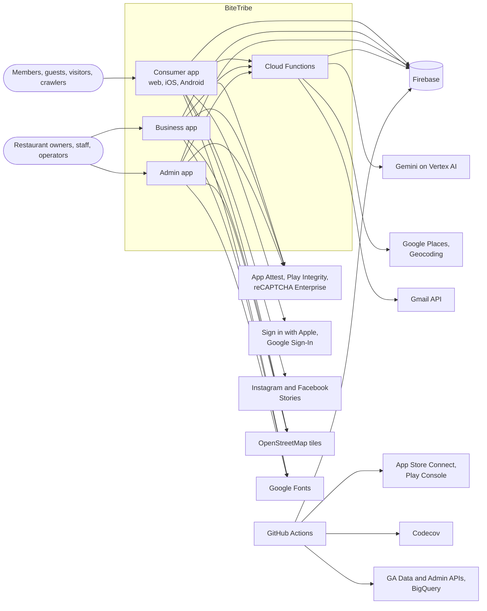

# Architecture - Context

## Purpose

What BiteTribe talks to: who uses it, and every external system the code calls. This page
is the context view of the architecture (arc42 section 3). It names each system once and
links the page that owns its detail; it does not restate that detail.

What BiteTribe is built from is [Architecture - Overview](overview.md). How the systems are
reached from each stage is [Architecture - Environments](environments.md).

**Verified against the code on 16 November 2026**, branch `develop` at `774a6c77`: the
runtime dependencies of `package.json` and `apps/bite-tribe-firebase/functions/package.json`,
the hostnames in non-test source under `apps/` and `libs/`, and the actions used in
`.github/workflows/`.

## Business Context

Who reaches BiteTribe, by the surface they use. Who they are and what they may do is
[User Roles](../product/user-roles.md); this page names them only to place them at the
boundary.

| Surface                                        | Reached by                                                     |
| ---------------------------------------------- | -------------------------------------------------------------- |
| Consumer app, on iOS, Android and the web      | members                                                        |
| The consumer app's open routes, in the browser | table guests, unauthenticated visitors, search engine crawlers |
| Business app                                   | restaurant owners and their staff                              |
| Admin app                                      | operators                                                      |

Nobody signs into the backend: Cloud Functions act with admin credentials and no role.

## Technical Context

One row per external system the code calls. `Called from` names the code or workflow that
reaches it; `Owner` names the page that holds the detail.

| System                                                                                                     | Used for                                                                                                                                                                                                            | Flows to and from it                                                                                                                                                                                                                                                              | Called from                                                                                                                                                                                                                                                                                                                | Owner                                                                                                                                                                                         |
| ---------------------------------------------------------------------------------------------------------- | ------------------------------------------------------------------------------------------------------------------------------------------------------------------------------------------------------------------- | --------------------------------------------------------------------------------------------------------------------------------------------------------------------------------------------------------------------------------------------------------------------------------- | -------------------------------------------------------------------------------------------------------------------------------------------------------------------------------------------------------------------------------------------------------------------------------------------------------------------------- | --------------------------------------------------------------------------------------------------------------------------------------------------------------------------------------------- |
| Firebase: Auth, Firestore, Storage, Functions, Hosting, App Check, Cloud Messaging, Analytics, Crashlytics | identity, product data, images, callables, triggers and scheduled jobs, serving the three web apps and Storybook, checking that a request comes from a genuine app, push notifications, telemetry and crash reports | from the apps: sign-ins, documents, image uploads, callable requests, App Check tokens, device tokens, events and crash reports; to the apps: ID tokens, documents, download URLs, callable results, notifications; from CI: the built web apps, the rules, indexes and Functions | `libs/common/ta-firestore`, `libs/bite-tribe/api`, `libs/common/push-notifications` through `firebase` and `@capacitor-firebase/*`; `apps/bite-tribe-firebase/functions` through `firebase-admin` and `firebase-functions`; the hosting targets in `firebase.json` and the deploy jobs in `.github/workflows/pipeline.yml` | [Architecture - Firebase](firebase.md); for sign-in [Architecture - Auth](auth.md), for telemetry [Architecture - Analytics](analytics.md), for push [Architecture - Capacitor](capacitor.md) |
| Sign in with Apple, Google Sign-In                                                                         | the two third-party sign-in providers behind Firebase Auth                                                                                                                                                          | the provider's credential in, a Firebase session out; the provider's avatar, mirrored into Storage                                                                                                                                                                                | `libs/common/ta-firestore/src/lib/auth.service.ts`, `libs/bite-tribe/api/src/lib/utils/check-user-profile-image-and-mirror-to-firebase.ts`                                                                                                                                                                                 | [Architecture - Auth](auth.md)                                                                                                                                                                |
| App Attest, Play Integrity, reCAPTCHA Enterprise                                                           | attesting to Firebase App Check that the device runs a genuine BiteTribe app                                                                                                                                        | an attestation from the device, a verdict back that App Check turns into a token                                                                                                                                                                                                  | `apps/bite-tribe-ios/ios/App/App/AppDelegate.swift`, `apps/bite-tribe-android/android/app/src/release/java/com/bitetribe/app/AppCheckProviderInstaller.java`, `libs/common/ta-firestore/src/lib/initialize-firebase-app-check.ts`                                                                                          | [Architecture - Firebase](firebase.md), [Architecture - Environments](environments.md)                                                                                                        |
| Gemini on Vertex AI                                                                                        | the generated Bite description                                                                                                                                                                                      | a shrunken Bite image and a prompt out, a description in                                                                                                                                                                                                                          | `apps/bite-tribe-firebase/functions/src/functions/shared/utils/gemini.ts`                                                                                                                                                                                                                                                  | [Architecture - AI](ai.md)                                                                                                                                                                    |
| Google Places API                                                                                          | searching places and reading a place's details                                                                                                                                                                      | a query or a position out, places in                                                                                                                                                                                                                                              | `apps/bite-tribe-firebase/functions/src/functions/restaurants/search-places.ts`, `apps/bite-tribe-firebase/functions/src/functions/restaurants/get-place-details.ts`                                                                                                                                                       | [Architecture - Firebase](firebase.md), `Google Maps Platform Trust Boundary`                                                                                                                 |
| Google Geocoding API                                                                                       | addresses, cities and currencies from a position, and positions from an address                                                                                                                                     | a position or an address out, an address or a position in                                                                                                                                                                                                                         | `apps/bite-tribe-firebase/functions/src/functions/shared/utils/geocode.ts`, `apps/bite-tribe-firebase/functions/src/functions/shared/utils/reverse-geocode.ts`                                                                                                                                                             | [Architecture - Firebase](firebase.md), `Google Maps Platform Trust Boundary`                                                                                                                 |
| Gmail API of Google Workspace                                                                              | the product's own email: verification, reminders, follow-ups, visit summaries                                                                                                                                       | a delegated access token from Google's OAuth endpoint, then the message out                                                                                                                                                                                                       | `apps/bite-tribe-firebase/functions/src/functions/users/google-workspace-email.ts`                                                                                                                                                                                                                                         | [Implementation - Firebase Functions](../implementation/firebase-functions.md), [Mail Authentication](../operations/mail-authentication.md)                                                   |
| OpenStreetMap tiles                                                                                        | the map                                                                                                                                                                                                             | map tiles in                                                                                                                                                                                                                                                                      | `libs/bite-tribe-common/map/src/lib/map/utils/create-openstreetmap-layer.ts`, through Leaflet                                                                                                                                                                                                                              | [Implementation - Ionic Patterns](../implementation/ionic-patterns.md), `Maps`                                                                                                                |
| Google Fonts                                                                                               | the Outfit typeface of the three apps                                                                                                                                                                               | the stylesheet and font files in, at runtime                                                                                                                                                                                                                                      | `apps/bite-tribe/src/theme/variables.scss`, `apps/bite-tribe-business/src/theme/variables.scss`, `apps/bite-tribe-admin/src/theme/variables.scss`                                                                                                                                                                          | this page; no other page covers it                                                                                                                                                            |
| Google Analytics Data and Admin APIs, BigQuery                                                             | the launch-analytics reports, the weekly digest and the provisioning of custom definitions                                                                                                                          | queries out, reports in                                                                                                                                                                                                                                                           | `tools/analytics`, `.github/workflows/analytics-digest.yml`                                                                                                                                                                                                                                                                | [Analytics Operations](../operations/analytics-operations.md)                                                                                                                                 |
| Instagram and Facebook Stories, through a Meta app registration                                            | sharing a Bite image into a story                                                                                                                                                                                   | the image handed to the Instagram or Facebook app on the device, with the Meta App ID as its source                                                                                                                                                                               | `apps/bite-tribe-ios/ios/App/App/SocialSharePlugin.swift`, `apps/bite-tribe-android/android/app/src/main/java/com/bitetribe/app/SocialSharePlugin.java`, `libs/common/social-share`                                                                                                                                        | [Architecture - Capacitor](capacitor.md)                                                                                                                                                      |
| App Store Connect, Play Console                                                                            | distributing the native apps                                                                                                                                                                                        | signed builds and their release notes out                                                                                                                                                                                                                                         | `xcrun altool` and `r0adkll/upload-google-play` in `.github/workflows/native-release.yml`                                                                                                                                                                                                                                  | [Implementation - Release And Build Workflow](../implementation/release-and-build-workflow.md)                                                                                                |
| GitHub Actions                                                                                             | CI, deploys and releases                                                                                                                                                                                            | the repository in; builds, deploys and comments out                                                                                                                                                                                                                               | `.github/workflows/`                                                                                                                                                                                                                                                                                                       | [Implementation - CI Pipeline](../implementation/ci-pipeline.md)                                                                                                                              |
| Codecov                                                                                                    | test coverage reports                                                                                                                                                                                               | coverage reports out, a pull request comment back                                                                                                                                                                                                                                 | `codecov/codecov-action` in `.github/workflows/pipeline.yml`, configured by `codecov.yml`                                                                                                                                                                                                                                  | [Implementation - CI Pipeline](../implementation/ci-pipeline.md)                                                                                                                              |

**Google Fonts has no owner yet.** All three apps import the stylesheet from
`fonts.googleapis.com` at runtime rather than bundling the typeface, and no SSOT page
says so. Whether to keep it is a product and privacy question, not decided here.

Behind Cloud Functions sit Google Cloud services the platform provides rather than the code
calling them: Cloud Scheduler runs the `onSchedule` jobs and Secret Manager holds the
`defineSecret` values. They are part of the Firebase row, not systems of their own.

## System Boundary



## Not Integrations

These appear in the code but are links a user follows, not systems BiteTribe calls. They
do not belong in the context view:

- The links to BiteTribe's Instagram account, on the start page and on the city landing
  pages, and the social links a restaurant publishes on its page. Sharing into an Instagram
  or Facebook story is different: it needs BiteTribe's Meta app registration, and is a row
  above.
- The App Store and Google Play links to the store pages.
- The Google Maps directions link on a Bite's details page.

## Code Anchors

```text
package.json
apps/bite-tribe-firebase/functions/package.json
apps/bite-tribe-firebase/functions/src/functions/shared/utils
apps/bite-tribe-firebase/functions/src/functions/restaurants
apps/bite-tribe-firebase/functions/src/functions/users/google-workspace-email.ts
libs/common/ta-firestore
libs/common/push-notifications
libs/bite-tribe-common/map
firebase.json
.github/workflows
codecov.yml
tools/analytics
```

## Related Pages

- [Architecture - Overview](overview.md)
- [Architecture - Environments](environments.md)
- [Architecture - Firebase](firebase.md)
- [User Roles](../product/user-roles.md)
