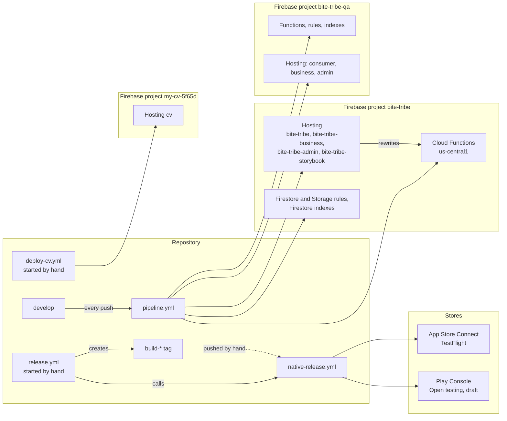

# Architecture - Deployment

## Purpose

Where every part of BiteTribe runs, and how a change gets there. This page is the deployment
view of the architecture (arc42 section 7). It names each deploy target once, with the
project or store it runs in and the workflow job that puts it there, and links the page that
owns the detail.

The stages a build can point at are [Architecture - Environments](environments.md). Firebase
as an external system is a row of [Architecture - Context](context.md).

**Verified against the code on 16 November 2026**, branch `develop` at `8ed6410f`: the
Hosting targets in `.firebaserc` and `firebase.json`, the backend configuration in
`apps/bite-tribe-firebase/firebase.json` and `apps/bite-tribe-firebase/.firebaserc`, and the
jobs and triggers in `.github/workflows/`.

## Runtime Topology

One row per Hosting target, per backend deployment and per native channel.
`npm run check:ssot` fails (rule `DEPLOY`) when a Hosting target in `.firebaserc` or a file
in `.github/workflows/` is not named on this page, so the view cannot fall behind the
deployment unnoticed.

| What                                                                                                                                     | Where it runs                                                                          | How it gets there                                                                                                             |
| ---------------------------------------------------------------------------------------------------------------------------------------- | -------------------------------------------------------------------------------------- | ----------------------------------------------------------------------------------------------------------------------------- |
| Consumer web app; its `/s/**`, `/eat/**`, `/download` and `/unsubscribe/**` rewrites call Functions, and `/imprint` serves a static page | Hosting target `bite-tribe` in project `bite-tribe`                                    | `deploy-bite-tribe` in `pipeline.yml`                                                                                         |
| Business app                                                                                                                             | Hosting target `bite-tribe-business` in project `bite-tribe`                           | `deploy-bite-tribe-business` in `pipeline.yml`                                                                                |
| Admin app                                                                                                                                | Hosting target `bite-tribe-admin` in project `bite-tribe`                              | `deploy-bite-tribe-admin` in `pipeline.yml`                                                                                   |
| Storybook                                                                                                                                | Hosting target `bite-tribe-storybook` in project `bite-tribe`                          | `deploy-bite-tribe-storybook` in `pipeline.yml`, once `loki` passed                                                           |
| Cloud Functions                                                                                                                          | project `bite-tribe`, region `us-central1`, the default, because no function sets one  | `deploy-functions` in `pipeline.yml`, once `deploy-firestore-indexes` finished                                                |
| Firestore and Storage rules                                                                                                              | project `bite-tribe`                                                                   | `deploy-firestore-rules` in `pipeline.yml`, once the emulator suite in `firestore-rules` passed                               |
| Firestore indexes                                                                                                                        | project `bite-tribe`                                                                   | `deploy-firestore-indexes` in `pipeline.yml`, which also waits until every declared index is `READY`                          |
| QA backend: Firestore rules and indexes, Storage rules, Functions                                                                        | project `bite-tribe-qa`                                                                | `deploy-qa-backend` in `pipeline.yml`                                                                                         |
| QA web apps: consumer, business, admin ([#2293])                                                                                         | `bite-tribe-qa`, `bite-tribe-qa-business` and `bite-tribe-qa-admin` on `bite-tribe-qa` | `deploy-qa-web` in `pipeline.yml`, after `deploy-qa-backend`                                                                  |
| iOS app                                                                                                                                  | App Store Connect, as a TestFlight build no tester group sees until one is assigned    | `release.yml`, started by hand, tags the build and calls `native-release.yml`, whose `ios` job uploads it with `xcrun altool` |
| Android app                                                                                                                              | Play Console, Open testing track (`beta`), as a draft                                  | the same release; the `android` job of `native-release.yml` uploads it with `r0adkll/upload-google-play`                      |
| CV site, outside the BiteTribe domain                                                                                                    | Hosting target `cv` in project `my-cv-5f65d`                                           | `deploy-cv.yml`, started by hand; it publishes only when started on `develop`                                                 |

Every `pipeline.yml` job above runs on a push to `develop`, and on a manual run of the
workflow on `develop`; none of them runs on a pull request. The Hosting targets are
configured in the root `firebase.json` and `.firebaserc`. The backend deploys run from
`apps/bite-tribe-firebase`, whose `firebase.json` holds the rules, indexes and Functions
and whose `.firebaserc` maps `default` to `bite-tribe` and `qa` to `bite-tribe-qa`.

## Workflows

Every file in `.github/workflows/`, with what it deploys. A workflow that deploys nothing is
named too, so that a new workflow is classified as a deploy or not when it arrives rather than
passed over. Triggers and jobs are owned by
[Implementation - CI Pipeline](../implementation/ci-pipeline.md).

| Workflow               | Deploys                                                                                                                            |
| ---------------------- | ---------------------------------------------------------------------------------------------------------------------------------- |
| `pipeline.yml`         | every row above in project `bite-tribe` or `bite-tribe-qa`, after the gate it also runs on every pull request                      |
| `release.yml`          | nothing itself; it cuts the release and calls `native-release.yml`                                                                 |
| `native-release.yml`   | the iOS and Android rows. It also runs on a pushed `build-*` tag and by hand, and a run started by hand uploads only when asked to |
| `deploy-cv.yml`        | the `cv` row                                                                                                                       |
| `analytics-digest.yml` | nothing; it posts the daily analytics digest to a GitHub issue, see [Analytics Operations](../operations/analytics-operations.md)  |

## Delivery Paths

A change reaches users by one of two paths, and which one decides how fast it arrives.

**Continuous: the web apps and the backend.** A merge to `develop` reaches the three web apps,
Storybook, the Functions, the rules and the indexes of production, and the QA backend, in one
pipeline run. Nobody starts a deploy for a normal change. Inside that run only one ordering is
enforced: `deploy-functions` waits for `deploy-firestore-indexes`. The Hosting deploys, the
rules deploy and the Functions deploy otherwise run side by side, so the live web apps and the
live backend can come from different steps of the run for some minutes, and for good when one
step fails. How the Functions deploy runs, what stays outside it and how it is recovered is
[Implementation - Firebase Functions](../implementation/firebase-functions.md).

**Released by hand: the native apps.** A native build reaches users only through a release,
which a person starts, usually on a Sunday ([Release Workflow](../overview/release-workflow.md)).
The release tags the commit and builds both apps from the tag; the uploads land in a state
no tester sees, a person finishes them in each store, and each user then updates in their own
time. The jobs, secrets and store states are
[Implementation - Release And Build Workflow](../implementation/release-and-build-workflow.md).

**The consequence: several versions run against one backend.** At any moment the production
backend serves:

- every native build still installed and not yet updated, back to the oldest one in use;
- the consumer web app in a tab opened before the last deploy, until its service worker has
  installed the new build and reloaded the page
  (`libs/bite-tribe/store/src/lib/service-worker/effects.ts`). The native apps register no
  service worker, per `Service Worker Rule` in [Architecture - Capacitor](capacitor.md);
- the business and admin apps in a tab opened before the last deploy, until it is reloaded.
  Neither builds a service worker.

## Compatibility Risk

A backend change goes live on merge, while the clients above keep calling the contract they
were built against. A change breaks them when it is one of these:

- a callable or `onRequest` route that changes its request or response shape, starts to
  require a field, or changes what an error code means;
- a Firestore document shape an older client still reads or writes: a renamed or retyped
  field, a field it relies on no longer being written, a moved collection;
- a security rule tightened so that it refuses a read or write an older client still makes.

Two neighbouring changes do not go live on merge. A function removed or renamed in the source
fails `deploy-functions`, because the deletion prompt fails under `--non-interactive`, and the
old function stays live. An index removed from `firestore.indexes.json` is skipped rather
than deleted. Both stay deliberate local commands, and a person running one meets the risk
then.

The risk runs the other way too: the web apps can go live before the Functions they call,
or without them when `deploy-functions` fails, as `Delivery Paths` describes.

**Nothing guards against it today.** No app checks a minimum version, and no page states a
rule for keeping the backend compatible with the clients in use. What exists limits the
window without closing it: the consumer web app's service worker prompts for and applies a
new build, and `sendNewVersionNotification`, fired by an operator from the admin app,
announces a native release that is live in a store. Neither stops an older client from
calling the changed backend.

This page states the risk and decides no remedy. How a backend change is kept compatible with
the clients still in use is open under `Release Questions` in
[Current State - Open Questions](../current-state/open-questions.md#release-questions).

## Stages

BiteTribe runs against three backends: the local Firebase emulators, `bite-tribe-qa` and the
production project `bite-tribe`. Only production serves users. QA has Hosting for the three web apps since [#2293], for testing only; QA receives the
same backend from the same commit. CI builds and deploys the QA web apps; the native builds that
run against QA are made on a workstation. There is no staging stage between `develop` and production. How a build
picks its stage, and why QA exists, is [Architecture - Environments](environments.md), which
owns the stages.

## Deployment Diagram



`analytics-digest.yml` deploys nothing and is left out.

## Code Anchors

```text
.firebaserc
firebase.json
apps/bite-tribe-firebase/.firebaserc
apps/bite-tribe-firebase/firebase.json
.github/workflows
apps/bite-tribe/project.json (serviceWorker)
libs/bite-tribe/store/src/lib/service-worker/effects.ts
apps/bite-tribe-firebase/functions/src/functions/notifications/send-new-version-notification.ts
tools/check-ssot.mjs (DEPLOY)
```

## Related Pages

- [Architecture - Environments](environments.md)
- [Architecture - Context](context.md)
- [Architecture - Firebase](firebase.md)
- [Architecture - Capacitor](capacitor.md)
- [Implementation - CI Pipeline](../implementation/ci-pipeline.md)
- [Implementation - Firebase Functions](../implementation/firebase-functions.md)
- [Implementation - Release And Build Workflow](../implementation/release-and-build-workflow.md)
- [Release Workflow](../overview/release-workflow.md)
- [Current State - Open Questions](../current-state/open-questions.md)
  [#2293]: https://github.com/muhammedgaygisiz/travellers-apps/issues/2293
