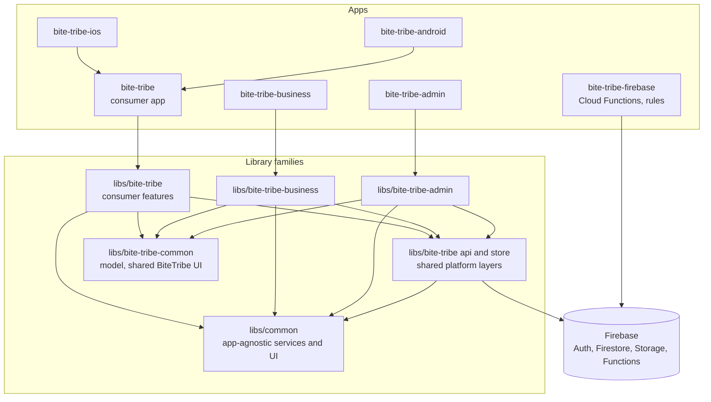

# Architecture - Overview

## Purpose

The architecture of BiteTribe is a modular Nx workspace around Angular, Ionic, Capacitor, Firebase, and shared domain libraries.

It should keep product features isolated enough for focused changes while still sharing the common domain model, store, Firebase access, UI components, and native capabilities.

## Shape

Every directory directly under `apps/` and `libs/` is named below. `npm run check:ssot`
fails (rule `BLOCKS`) when one is added without being named here, so this view cannot fall
behind the workspace unnoticed. The scope is the `scope:*` tag in the project's
`project.json`; [Architecture - Nx Workspace](nx-workspace.md) explains what the tags enforce,
and [Implementation - Code Map](../implementation/code-map.md) goes down to the single
library.

### Apps

| Path                           | Role                                                                                                             | Scope                                                |
| ------------------------------ | ---------------------------------------------------------------------------------------------------------------- | ---------------------------------------------------- |
| `apps/bite-tribe`              | The consumer app: the web app, and the bundle the native wrappers ship                                           | `scope:bite-tribe`                                   |
| `apps/bite-tribe-business`     | The business app, where restaurant owners and staff maintain their restaurants and run the service floor         | `scope:bite-tribe-business`                          |
| `apps/bite-tribe-admin`        | The admin app, the internal operations tool of the BiteTribe Operator                                            | `scope:bite-tribe-admin`                             |
| `apps/bite-tribe-firebase`     | The backend: Firestore and Storage rules, indexes and emulator setup, and the Cloud Functions under `functions/` | none on the project; `scope:firebase` on `functions` |
| `apps/bite-tribe-ios`          | The Capacitor iOS wrapper of the consumer app                                                                    | `scope:bite-tribe`                                   |
| `apps/bite-tribe-android`      | The Capacitor Android wrapper of the consumer app                                                                | `scope:bite-tribe`                                   |
| `apps/bite-tribe-e2e`          | Playwright end-to-end tests of the consumer app                                                                  | `scope:bite-tribe`                                   |
| `apps/bite-tribe-business-e2e` | Playwright end-to-end tests of the business app                                                                  | `scope:bite-tribe-business`                          |
| `apps/storybook-host`          | Storybook for the shared and feature UI states, and the visual regression baseline                               | `scope:bite-tribe`                                   |

### Library Families

| Path                       | Role                                                                                                            | Scope                       |
| -------------------------- | --------------------------------------------------------------------------------------------------------------- | --------------------------- |
| `libs/bite-tribe`          | The consumer features, and the platform layers every app shares: `libs/bite-tribe/api`, `libs/bite-tribe/store` | `scope:bite-tribe`          |
| `libs/bite-tribe-business` | The business app's features                                                                                     | `scope:bite-tribe-business` |
| `libs/bite-tribe-admin`    | The admin app's features                                                                                        | `scope:bite-tribe-admin`    |
| `libs/bite-tribe-common`   | The domain model and the BiteTribe UI more than one app uses: Bites, BiteTrails, the map, opening hours         | `scope:bite-tribe`          |
| `libs/common`              | Services and UI that know nothing of BiteTribe: Firebase bootstrap, toasts, haptics, sounds, geolocation        | `scope:common`              |

### Outside The BiteTribe Domain

| Path      | Role                                                                                                                                                                                                                             | Scope      |
| --------- | -------------------------------------------------------------------------------------------------------------------------------------------------------------------------------------------------------------------------------- | ---------- |
| `apps/cv` | A personal CV site. It shares the workspace tooling and nothing else: it imports no library under `libs/`, nothing imports it, and it deploys on its own, to its own Firebase project, through `.github/workflows/deploy-cv.yml` | `scope:cv` |

It is named so that a reader does not take it for part of the product. Nothing else in the
workspace belongs here.

### Building Blocks



The test, e2e and Storybook apps and `apps/cv` are left out of the diagram. What the system
talks to outside the workspace is [Architecture - Context](context.md).

## Core Principles

- Feature behavior lives in feature libraries.
- Shared domain types live in `libs/bite-tribe-common/model` only when multiple features need them.
- Shared Firebase/API access lives in `libs/bite-tribe/api`.
- App-wide client state lives in `libs/bite-tribe/store`.
- Backend-owned query semantics and side effects live in Firebase Functions.
- Native runtime concerns flow through Capacitor wrappers and sync targets.
- UI text uses Transloco keys across app locale files.

## Solution Strategy

The fundamental choices the architecture rests on, what each serves, and where it was decided.
This is a table of links: the reasoning stays on the decision it names. A choice that rests on
no recorded decision says so, and closing that gap is separate work rather than a rationale
written here. What each choice serves is what its decision gives; the ranked quality goals are on
[Architecture - Quality](quality.md).

| Choice                                                                                                                                | Serves                                                                              | Decided in                                                                                                                                                                               |
| ------------------------------------------------------------------------------------------------------------------------------------- | ----------------------------------------------------------------------------------- | ---------------------------------------------------------------------------------------------------------------------------------------------------------------------------------------- |
| The Bite, one dish someone ate, is the central entity; restaurants, menus, BiteTrails and the business tools support it               | the product question, what should I eat                                             | [ADR-0001 Dish First Product](../decisions/adr-0001-dish-first-product.md)                                                                                                               |
| Firebase is the backend platform, and backend-owned query semantics and side effects live in Cloud Functions                          | delivery speed and native integration; security through rules and App Check         | [ADR-0002 Firebase Backend](../decisions/adr-0002-firebase-backend.md)                                                                                                                   |
| One Nx monorepo, feature behavior in the smallest owning library, shared code in the library families above                           | focused changes across several apps that share one domain model                     | [ADR-0003 Nx Monorepo](../decisions/adr-0003-nx-monorepo.md)                                                                                                                             |
| BiteTribe never settles a table's bill; the restaurant does, and BiteTribe delivers a visit summary                                   | no funds, card data or fiscal claim in the product                                  | [ADR-0004 Table Payment Model](../decisions/adr-0004-table-payment-model.md), `RD-TS-45` and `RD-TS-46` in [Recorded Decisions](../decisions/recorded-decisions.md)                      |
| One Angular and Ionic codebase for the web, wrapped by Capacitor for iOS and Android, so the native apps ship the consumer web bundle | one product on three platforms                                                      | No recorded decision. [Architecture - Capacitor](capacitor.md) holds the rules that follow from it                                                                                       |
| App-wide client state in NgRx, in `libs/bite-tribe/store`                                                                             | one place for state that more than one feature reads                                | No recorded decision. [Architecture - State Management](state-management.md) describes the pattern                                                                                       |
| Visible text through Transloco keys, in every app locale                                                                              | use across languages                                                                | No recorded decision. [Architecture - Internationalization](internationalization.md) describes the pattern                                                                               |
| Public, indexable pages rendered by Cloud Functions behind Hosting rewrites, not routes of the Angular app                            | pages a search engine can index without public read rules or an App Check exemption | Epic [#1487], see its [record](../history/records/epic-1487.md)                                                                                                                          |
| The web apps and the backend deploy from every push to `develop`; the native apps are released by hand from a tag                     | a deployed state that is the reviewed commit, with no deploy from a workstation     | No ADR. Settled issue by issue: [#1464] for the Functions, [#1567] for the rules and indexes, [#1181] for the native builds. [Architecture - Deployment](deployment.md) shows the result |

## Feature Layering

```text
page
|-- presentation components
|-- containers
|-- integration services

data-access
|-- Angular resources
|-- Firebase reads
|-- feature-local request/result shapes

api
|-- shared Firebase/Firestore services
|-- storage helpers
|-- callable wrappers

store
|-- NgRx actions
|-- reducers
|-- effects
|-- selectors
```

## Decision Rule

When adding or changing behavior, put the change in the smallest layer that owns the behavior:

- Template-only display belongs in page components.
- Navigation and user workflow belongs in integration services.
- Remote reads and feature resource params belong in data-access.
- Shared Firebase operations belong in API services.
- App-wide derived state belongs in store selectors/effects.
- Backend query semantics belong in Firebase Functions.

## Code Anchors

```text
apps/bite-tribe
apps/bite-tribe-business
apps/bite-tribe-admin
apps/bite-tribe-firebase/functions
libs/bite-tribe
libs/bite-tribe-business
libs/bite-tribe-common/model
libs/bite-tribe/api
libs/bite-tribe/store
libs/common
tools/check-ssot.mjs
```

## Related Architecture Pages

- [Architecture - Context](context.md)
- [Architecture - Deployment](deployment.md)
- [Architecture - Nx Workspace](nx-workspace.md)
- [Architecture - Firebase](firebase.md)
- [Architecture - Capacitor](capacitor.md)
- [Architecture - Data Access](data-access.md)
- [Architecture - State Management](state-management.md)
- [Implementation - Code Map](../implementation/code-map.md)

[#1181]: https://github.com/muhammedgaygisiz/travellers-apps/issues/1181
[#1464]: https://github.com/muhammedgaygisiz/travellers-apps/issues/1464
[#1487]: https://github.com/muhammedgaygisiz/travellers-apps/issues/1487
[#1567]: https://github.com/muhammedgaygisiz/travellers-apps/issues/1567
