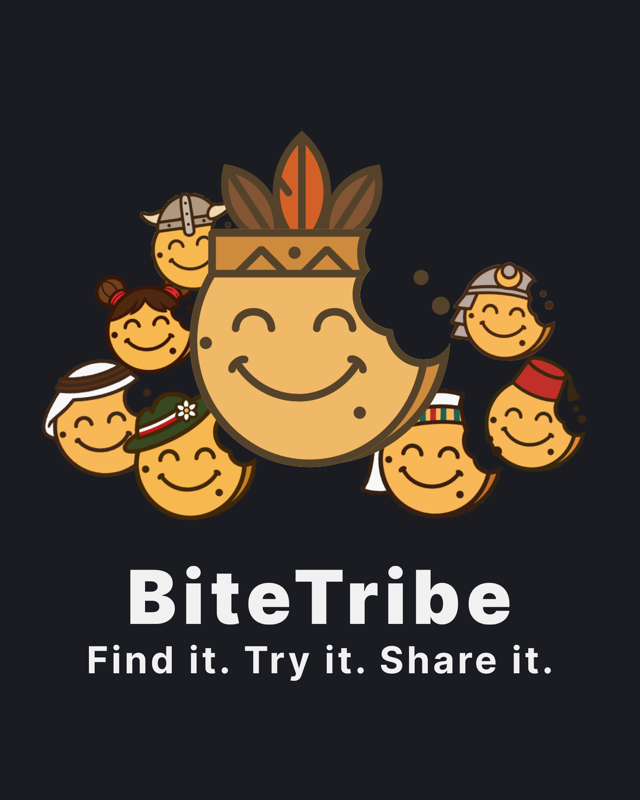
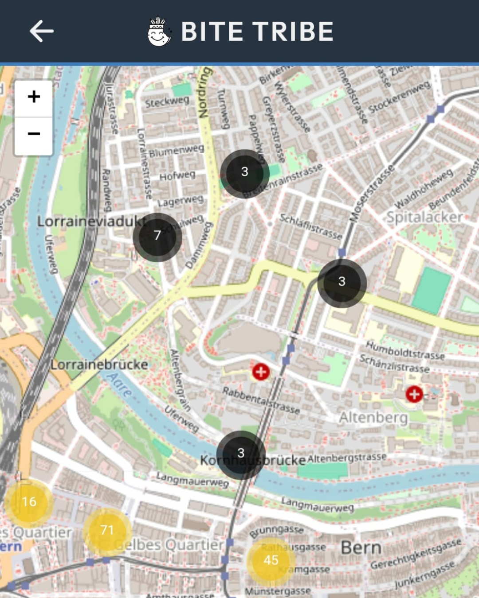
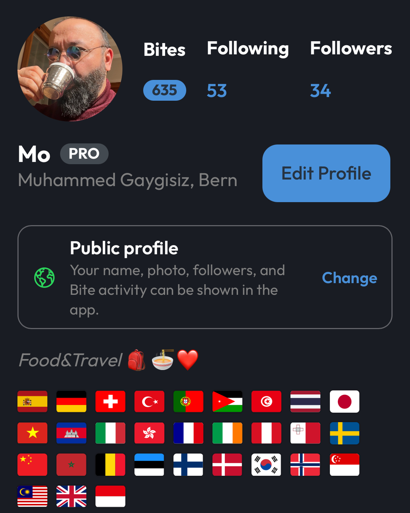
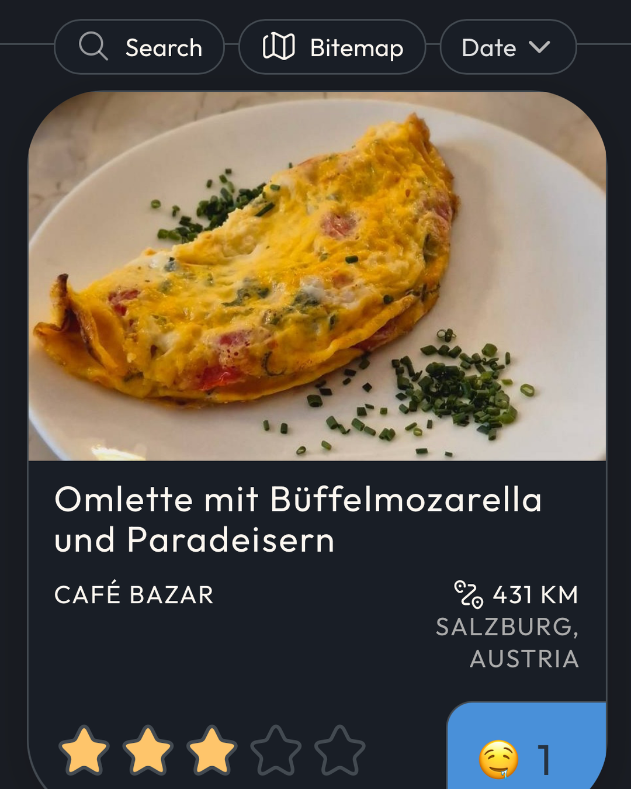
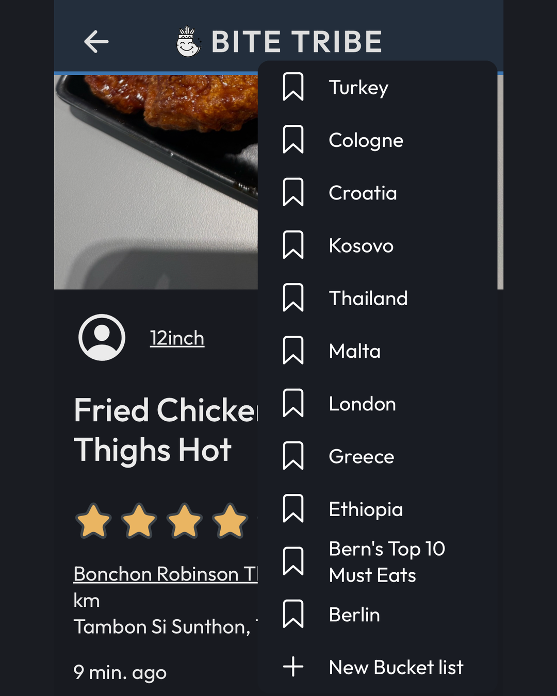
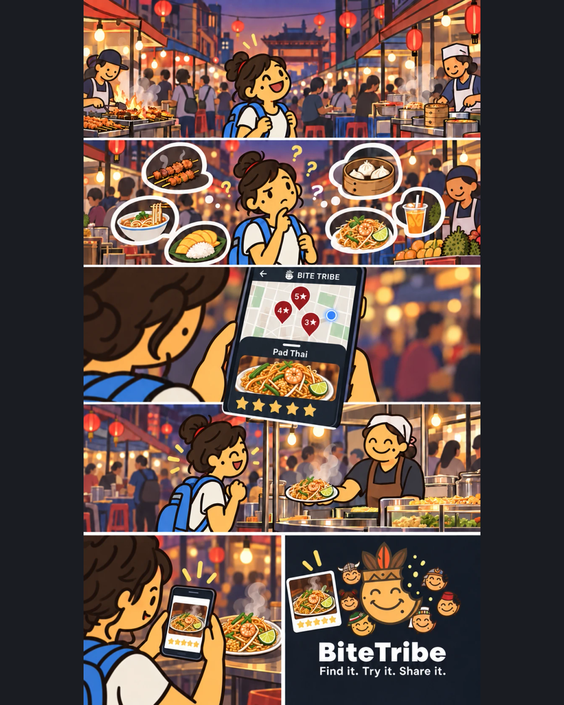
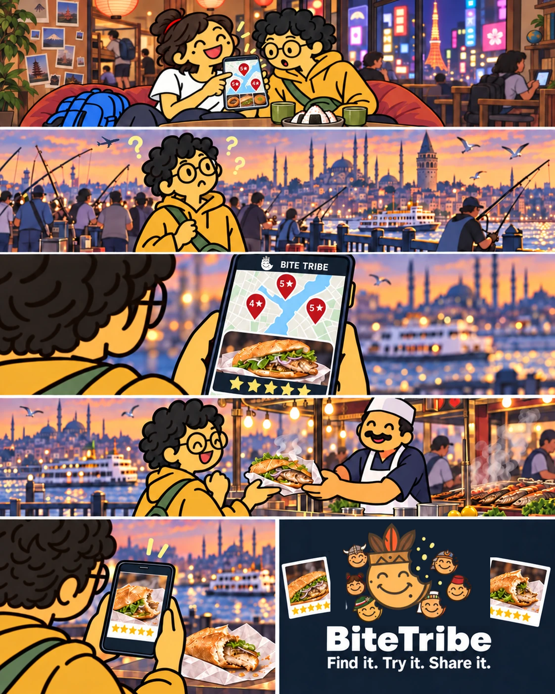
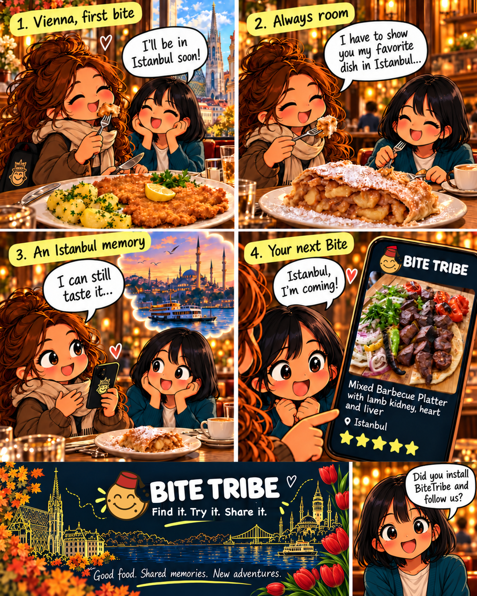
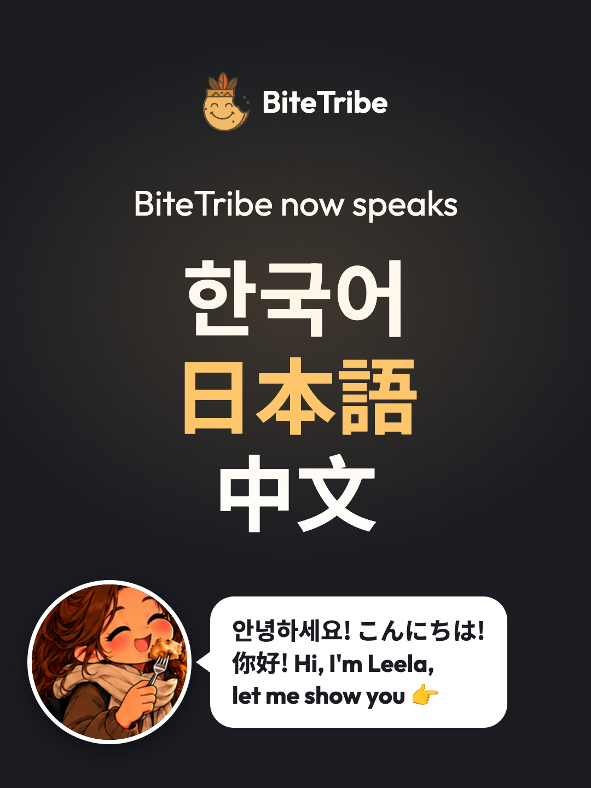

# Marketing - Social Media Channels

## Purpose

This page owns the BiteTribe social handle, the account inventory across every
platform, and the profile copy each one carries.

[Implementation - Store Listing Assets](../implementation/store-listing-assets.md) owns the approved product copy and the
name spelling. [Implementation - Web Search And Social Metadata](../implementation/web-search-and-social-metadata.md) owns what the
web app tells crawlers and unfurlers. This page owns the accounts themselves, and
it is the reason `twitter:site` in `apps/bite-tribe/src/index.html` has a value
to point at.

Added 1 September 2026 for
[issue #1455][#1455],
which is a prerequisite for
[#913], the
public launch campaign. That campaign lists Instagram, Reddit, LinkedIn and
travel communities in its scope, and none of the channels existed.

## The Handle

**`bitetribeapp` is the handle, everywhere. Decided 1 September 2026.**

Not `bitetribe`. That is the point of the decision, and the reason it was taken
as a decision rather than assumed.

`bitetribeapp` was chosen over `getbitetribe`, `bitetribehq` and `bitetribe_app`,
all of which were equally available on the day:

- It is the wordmark plus the one word that disambiguates it, so it stays
  readable as _BiteTribe app_ when said aloud.
- No separator. Instagram and TikTok both normalise `_` and `.` inconsistently in
  in-app search, and an underscore is a mistyped character on a phone keyboard.
- `get-` is a SaaS download convention. It reads as a call to install, which is
  the wrong verb for an account someone is meant to follow.
- `-hq` positions the account as the company talking about itself. That suits a
  B2B tool, not a dish-first consumer feed.

Twelve characters, so it also fits X's fifteen-character limit with room to
spare.

## The @bitetribe Conflict

**`@bitetribe` on Instagram is not us, and never will be.** Write this down once
so the campaign does not rediscover it as a surprise.

It belongs to a Manchester food business - bagels and Thai food - with 3,645
followers as of 1 September 2026, bio _"Dive into the heart of culinary joy, one
bite at a time!"_. On that date it was the **second Google result** for the query
`bitetribe`, above our own site.

Three consequences that are true today and get worse the more the name is
promoted:

- Anyone searching Instagram for us finds them first.
- Any campaign that says "find us on Instagram" without the handle sends traffic
  to them.
- They write themselves **Bite Tribe**, with a space. Our own rule in
  [Implementation - Store Listing Assets](../implementation/store-listing-assets.md) is that the product is **BiteTribe**,
  one word, in prose. Following our own rule is therefore also the thing that
  distinguishes the two accounts at a glance. Do not let the spaced form creep
  into a profile display name.

`bitetribe` is separately taken on **TikTok** (a dormant account, 26 followers,
no bio, no posts) and on **YouTube**. It is free on X, Pinterest and Bluesky, and
we are deliberately not taking it there: one handle everywhere is worth more than
a prettier handle on the three platforms that happen to still have it. A brand
that is `@bitetribeapp` on Instagram and `@bitetribe` on X is a brand nobody can
guess.

## Availability, Verified 1 September 2026

`bitetribeapp` was clear on every platform that can be checked without an
account:

| Platform  | Handle          | Checked how                                             |
| --------- | --------------- | ------------------------------------------------------- |
| Instagram | `@bitetribeapp` | Profile page returns _Profile isn't available_          |
| TikTok    | `@bitetribeapp` | Profile page returns _Couldn't find this account_       |
| X         | `@bitetribeapp` | `api.x.com/i/users/username_available.json` → available |
| YouTube   | `@bitetribeapp` | `youtube.com/@bitetribeapp` → `404`                     |
| Pinterest | `/bitetribeapp` | Profile HTML carries no embedded user JSON              |
| Threads   | `@bitetribeapp` | Inherited from Instagram, see below                     |
| Bluesky   | `bitetribe.app` | `resolveHandle` → unresolved                            |
| Facebook  | `/bitetribeapp` | **Not verifiable logged out** - confirm at signup       |

Two of those rows carry real caveats:

- **Facebook** shows the identical _This content isn't available at the moment_
  wall for a real page and a nonexistent one when signed out. It is the one
  platform where availability is only known at the moment of registration.
- **Threads** has no separate handle namespace. A Threads account is created from
  an Instagram account and takes that account's username. Registering Instagram
  therefore settles Threads, and the correct order is Instagram first.

Availability decays. Re-check before registering if this has sat for more than a
few days.

### Bluesky Takes The Domain

Bluesky handles are domain names, and we own `bitetribe.app`. The handle there is
**`@bitetribe.app`**, set by publishing a `_atproto` DNS TXT record or serving
`/.well-known/atproto-did`, not `bitetribeapp.bsky.social`. It is free, it is
self-verifying, and it is the one platform where we get the clean name.

Registering `bitetribeapp.bsky.social` first and moving to the domain afterwards
is the low-risk order, because the domain handle can be changed later and the
fallback cannot be lost. Done that way on 2 September 2026.

**The HTTPS verification method does not work for us.** Bluesky can verify a
domain by fetching `/.well-known/atproto-did` as plain text, but
`https://bitetribe.app/.well-known/atproto-did` returns `200` with
`text/html` - it is the SPA's `index.html`, served by the catch-all rewrite. A
crawler asking for a DID gets the whole app. Making it work would need a hosting
rewrite exception; **use DNS instead.**

The account's DID is `did:plc:2s4ah3tthzk6f35bsbrzzgqg`, so the record is:

| Field | Value                                  |
| ----- | -------------------------------------- |
| Type  | `TXT`                                  |
| Name  | `_atproto.bitetribe.app`               |
| Value | `did=did:plc:2s4ah3tthzk6f35bsbrzzgqg` |

DNS is Cloudflare, where the name is entered as bare `_atproto` and the zone is
appended automatically. Added 2 September 2026 as record 15 of the zone; purely
additive, so the `A`, `CNAME` and `MX` records were untouched. It resolved on
Cloudflare and Google DNS immediately, and Bluesky verified it on the first
attempt.

**The handle is now `@bitetribe.app`.** `@bitetribeapp.bsky.social` stays
reserved to the same account and can be switched back to at any time, so nothing
was given up by moving.

Bluesky has **no website field**; the link lives in the description and is
auto-linked. That is why its bio carries `bitetribe.app` as a third line, which no
other platform's does. 256 characters, so the full copy fits untrimmed.

## Account Inventory

All accounts register under **`social@bitetribe.app`**, a role mailbox created
2 September 2026 for exactly this. Not a personal address: eight brand accounts
on someone's personal identity is eight accounts to unpick at handover, and the
recovery mail belongs to the project.

This table is the checklist, and it is updated as each handle is taken.

| Platform  | Handle           | Intent  | Status                                        |
| --------- | ---------------- | ------- | --------------------------------------------- |
| Instagram | `@bitetribeapp`  | Primary | **Registered 2 Sep 2026**                     |
| TikTok    | `@bitetribeapp`  | Primary | **Registered 2 Sep 2026**                     |
| Pinterest | `/bitetribeapp`  | Active  | **Registered 2 Sep 2026**                     |
| Threads   | `@bitetribeapp`  | Reserve | **Registered 2 Sep 2026**                     |
| X         | `@bitetribeapp`  | Reserve | **Registered 2 Sep 2026**                     |
| Facebook  | `/bitetribeapp`  | Reserve | **Registered 2 Sep 2026**                     |
| YouTube   | `@bitetribeapp`  | Reserve | **Registered 2 Sep 2026**                     |
| Bluesky   | `@bitetribe.app` | Reserve | **Registered 2 Sep 2026**, domain handle live |

**Reserve** means the handle is held so nobody else can take it. Registration is
cheap; a name conflict discovered mid-campaign is not, as `@bitetribe` on
Instagram already demonstrates.

**Reddit is deliberately absent.** You do not set up a Reddit channel, you
participate in existing communities, and a brand account posting into `r/food` or
a city subreddit reads as spam and gets removed. That is outreach and belongs to
[#913].

## The Meta App

Instagram's and Facebook's Stories share APIs reject a share that carries no
registered Meta App ID, so BiteTribe has a Meta app even though it ships no Meta
SDK. Registered 29 October 2026 for [#1729]; [#1730] puts the ID into the app.

| Field            | Value                                                             |
| ---------------- | ----------------------------------------------------------------- |
| App name         | `BiteTribe`                                                       |
| App ID           | `1431506688471796`                                                |
| Owner            | **BiteTribe** Meta business portfolio, ID `1059515020497260`      |
| Admin            | Muhammed                                                          |
| Contact email    | `social@bitetribe.app`                                            |
| Mode             | Development                                                       |
| iOS bundle ID    | `com.bitetribe.app`                                               |
| Android package  | `com.bitetribe.app`, class `com.bitetribe.app.MainActivity`       |
| Android key hash | `SFUn0tUDoFQhKQDT+8jEP2EoDdQ=` and `XkO+86h58B8xHya/dQBFz/JCGhc=` |

**The App ID is public, and it is the only Meta value the project needs.** iOS
sends it in the `source_application` pasteboard key; Android sends it in the
`source_application` intent extra for Instagram and `com.facebook.platform.APP_ID`
for Facebook Stories. The App Secret and client token are never committed or
shared - with no Meta SDK, nothing uses them.

**The portfolio owns the app, not a person.** The same portfolio owns the
BiteTribe Facebook Page, so handover is adding an admin to the portfolio rather
than moving the app.

The two key hashes are the base64 SHA-1 fingerprints already registered on the
Firebase Android app, so Meta and Firebase recognise the same signing keys.

**No App Review.** The app has no use cases and no permissions; the Stories share
APIs need neither. It stays in Development mode unless testing on [#1730] shows
Instagram or Facebook rejecting shares from a Development-mode ID, in which case
it is switched to Live.

## Profile Content

The same on every platform, so the accounts read as one brand. All of it is
existing approved copy from [Implementation - Store Listing Assets](../implementation/store-listing-assets.md); none of it
is new marketing writing.

| Field        | Value                                                                 |
| ------------ | --------------------------------------------------------------------- |
| Display name | `BiteTribe`                                                           |
| Website      | `https://bitetribe.app`                                               |
| Category     | Food & Drink, where the platform asks                                 |
| Avatar       | [`ssot/marketing/assets/social/avatar.png`](assets/social/avatar.png) |

**Leave the link title blank** where a platform offers one, as Instagram and
Threads both do. YouTube requires one, so it gets `bitetribe.app` as the title -
which displays the domain, achieving the same thing the blank convention does
elsewhere. Empty means the profile renders `bitetribe.app`, which already
reads as the product name plus the word app. A title replaces that, and every
candidate is worse: `BiteTribe` is the third repetition of the word in a
four-line profile, and a call to action hides the domain we want remembered.

**Display name is `BiteTribe`, one word.** This is the name spelling rule in
[Implementation - Store Listing Assets](../implementation/store-listing-assets.md) applied to a new surface, and here it
does double duty as the thing that tells us apart from `Bite Tribe` on Instagram.
The spaced form is correct in exactly two places, and neither of them is a social
profile.

Bio, in three lines, because the platforms disagree about how much room to give
you:

```text
Find it. Try it. Share it.
Every pin on the map is one real dish, photographed by the person who ate it, with the price they paid and what they honestly thought.
```

That sentence is 133 characters, which fits Instagram's 150 and Pinterest's 160.
Where the limit is tighter, keep the tagline and trim the sentence rather than
rewriting it. The sentence is the approved App Store promotional text and the web
app's meta description, so it is already the claim the product makes everywhere
else. Changing it means changing it in
[Implementation - Store Listing Assets](../implementation/store-listing-assets.md) first.

### Per-Platform Bio Trims

Instagram caps the bio at 150 characters and the full copy is 161, so the
sentence drops `on the map` and lands at exactly 150 with the tagline intact.
That is the one lossless cut - Instagram has no map to refer to:

```text
Find it. Try it. Share it.
Every pin is one real dish, photographed by the person who ate it, with the price they paid and what they honestly thought.
```

Trim the sentence, never the tagline, and never rewrite the claim.

### Instagram's Website Field Is Mobile-Only

The `Website` field on `instagram.com/accounts/edit/` is inert. The page says so -
_"Editing your links is only available on mobile"_ - and a write to it is
silently discarded with no error. **The profile link must be set in the Instagram
mobile app**, under Edit profile - Links. Everything else on the profile,
including the avatar and the bio, sets correctly from the web.

Forcing a 420px viewport does not help. Instagram serves the same web app at
every width, so there is no mobile web layout to fall back to - it is the native
app or nothing.

Set from the app on 2 September 2026. Instagram rewrites every outbound profile
link through `l.instagram.com/?u=...`; that wrapper is theirs and unavoidable,
and the target is the canonical `https://bitetribe.app/`.

### Threads Saves Bio And Links Separately, And They Fight

Threads' edit-profile dialog has sub-dialogs for `Bio` and `Links`, each with
their own `Done`, plus a main `Done` at the bottom. They do not compose:

- The bio sub-dialog does **not** persist on its own. Escaping the outer dialog
  discards it. It needs the main `Done`.
- A link **does** persist immediately from its own sub-dialog.
- The main `Done` then submits a stale profile object and **wipes the link that
  was already saved**.

Observed both directions on 2 September 2026. The order that works:

1. Set the bio, `Done` on the sub-dialog, then the main `Done`. Bio is now live.
2. Re-open the dialog, add the link, `Done` on its sub-dialog only.
3. Leave with `Escape`. Do **not** press the main `Done` again.

Reload the profile before believing any of it - the profile behind the dialog
renders optimistically and showed the link for a while after it had been wiped.

### TikTok Blocks Signup From An Automated Browser

TikTok bounced the web signup to `/login/download-app` - _"For security purposes,
continue on the TikTok app"_ - with a QR code that only downloads the app. Driving
the browser through an extension is the likely trigger; it was the only platform
of the eight to do this.

**Do not retry it from the browser.** TikTok flags accounts created from sessions
it finds suspicious, and the downside is losing the handle on the platform where
`bitetribe` is already squatted. Sign up in the app, then log in on the web -
login and profile editing are not gated, only account creation is.

### TikTok's Own Limits

Four of them, all discovered on 2 September 2026 and all easy to trip:

| Limit               | Value                                                 |
| ------------------- | ----------------------------------------------------- |
| Bio                 | **80 characters**, against Instagram's 150            |
| Username change     | Once every **30 days**                                |
| Display name change | Once every **7 days**                                 |
| Profile link        | Needs **1,000 followers**. No field exists below that |

**TikTok never asks for a username at signup.** It derives one from the display
name - ours became `bitetribe5` - and you change it afterwards in Edit profile.
With a 30-day lock, that is one shot before the launch window.

The 80-character bio does not fit the full copy at 161, or even the Instagram trim
at 150. TikTok gets its own, keeping the tagline and the claim that actually
differentiates the product, at 75:

```text
Find it. Try it. Share it.
Real dishes, photographed by those who ate them.
```

**TikTok carries no link to `bitetribe.app`,** and cannot until 1,000 followers.
This is the one acceptance criterion of
[#1455] that a
platform refuses rather than we skipped. Revisit at 1k.

### Pinterest Is A Business Account

Registered through `pinterest.com/business/create/` rather than the consumer
signup. Free, and unlike Instagram's business account it costs nothing - there is
no music-library equivalent to lose. It is also the only one of the eight that
takes our category as a first-class field: **Food and drink**, matching
[Implementation - Store Listing Assets](../implementation/store-listing-assets.md) exactly.

Onboarding answers, none of them load-bearing but all recorded so they are not
re-guessed:

| Question          | Answer                                                                   |
| ----------------- | ------------------------------------------------------------------------ |
| Business type     | `Other` - we are a consumer app, and every other option mis-describes us |
| Brand focus       | `Food and drink`                                                         |
| Goals             | Drive traffic to your site, Grow brand awareness                         |
| Interested in ads | Yes, consistent with keeping ads open for [#913]                         |

`Other` was chosen deliberately: `Online merchant or marketplace` would steer
Pinterest into product-catalogue tooling we cannot fill, and `Publisher or media`
means magazines and news outlets. Pinterest says the choice is updatable, and it
does not gate website claiming.

### Two Pinterest Traps

**The `Imprint` field sits directly above `Username`.** Imprint is the EU legal
disclosure (Impressum). It is easy to write the handle into it by mistake, and it
is publicly visible. Ours is deliberately empty.

**Pinterest rewrites `https://` to `http://` on save.** The stored profile link
is `http://bitetribe.app/` no matter what is typed. Harmless - the host 301s to
`https://bitetribe.app/`, verified on the day - so it costs one redirect hop and
lands on the canonical. Do not keep re-fixing it; Pinterest wins.

Pinterest also flattens the bio's line break into a single paragraph. The text is
intact and it reads fine, so the tagline is not given its own line there.

### X Allows Email Signup Only In The App

X's web signup offers phone, Google or Apple. Choosing `Email or username` and
continuing produces a QR code and the flat statement **"Email signups are only
allowed on the apps"**. Unlike TikTok this is documented product behaviour rather
than an anti-automation block, and it does not go away by retrying.

That matters because the web path would attach a **personal phone number** as the
account's identity, breaking the pattern where all eight sit on
`social@bitetribe.app`. Sign up in the X app with email instead.

**Turn off "Let people find your account by your phone number or email"** if the
phone path is ever used. It is on by default, and on a brand account registered
with a personal number it makes that number a public lookup key for the brand.

X keeps `https://` on the profile link, wrapped through `t.co`. Verified on the
day: the profile's `t.co` resolves to `https://bitetribe.app`. Better behaviour
than Pinterest, which downgrades to `http`.

### YouTube Is The One Account Not On The Role Address

`social@bitetribe.app` is a **Workspace alias, not a Google account**. Mail to it
is delivered - which is all the other seven platforms need - but it cannot sign
in to Google, and the public "Create account" flow will not provision it either,
because `bitetribe.app` is a Workspace-managed domain. Attempting it drops you
into creating an unrelated `@gmail.com` address, which is worse than the
alternative.

So the channel sits on **`muhammed.gaygisiz@bitetribe.app`**, an org-owned
Workspace account. Not a personal Gmail, but not the role address either.

**It is a personal channel, not a Brand Account, and that could not be fixed on
the day.** Both routes are closed:

- Creating the channel through `youtube.com/channel_switcher` produces a personal
  channel despite that being the path usually recommended for a Brand Account.
- `youtube.com/account_transfer_channel` moves a channel only into a Brand
  Account that **already exists**, and reports _"No other accounts available"_
  when none does. `myaccount.google.com/brandaccounts` lists Brand Accounts but
  offers no way to create one - Google has withdrawn self-serve creation.

The consequence: the channel is welded to one Google user rather than being an
entity that user merely manages. Handing it over means moving the channel, not
just adding an owner.

**The fix, when someone wants it:** provision `social@bitetribe.app` as a real
Workspace user (removing the alias first, since the two conflict), then move the
channel to it. Cheapest while the channel is empty - no videos, no subscribers,
nothing to migrate - and it gets harder with every upload.

### Facebook Hides The Page Username Setting

The Page exists and is fully configured, but it lives at
`facebook.com/profile.php?id=61594035570286`. **There is no username, and
Facebook offers no way to set one on a new Page.** Checked on 2 September 2026:

- `Settings - Page setup` lists Name, Page access, Page type, management history,
  status, recommendation, messaging. No username.
- `Settings - How people can find and contact you` is search-engine linking,
  recommendations and messaging only.
- Searching the settings for `username` returns `Name` and nothing else.
- `About - Names` offers name pronunciation and other names.

The field is not absent, only well hidden - it was found later the same day and
`bitetribeapp` was set successfully, so `facebook.com/bitetribeapp` now resolves
to the Page. **The lesson is where it is not:** not in Page setup, not in "How
people can find and contact you", not in About - Names, and not surfaced by
searching the settings for `username`.

That also finally answered the one question that could not be checked up front.
`facebook.com/bitetribeapp` returns the generic _"This content isn't available at
the moment"_ wall for a nonexistent handle **even when signed in**, and `curl`
gets an HTTP `400`, so availability was unknowable until the moment of claiming
it. **It was free.** The handle is now ours on all eight platforms with no
variants.

Two Page settings worth keeping as they are: **Data sharing is off**, and
**"Allow search engines outside Facebook to link to your Page" is on** - the
latter matters, because the Page is one more surface competing with the Manchester
`@bitetribe` accounts for our own name.

A Facebook Page is also the one account created from a **personal profile** rather
than `social@bitetribe.app`; there is no email-only path. Admins can be added, so
handover is by permission rather than transfer.

### Meta's Consent-Or-Pay Gate, And Why We Kept Personalised Ads

Some time after signup, Instagram blocks the profile editor with an EU
consent-or-pay interstitial: subscribe from CHF 5.00/month for no ads, or use it
free and consent to data processing for ads. It cannot be dismissed - it blocks
`accounts/edit/` until answered.

**We chose free-with-ads, and deliberately kept _personalised_ ads.** Decided
2 September 2026.

The screen offers a middle option, less-personalised ads, which is the
privacy-preserving choice and was the obvious pick until its confirmation screen
said the quiet part:

> Your ability to **advertise and monetise with ads** will be limited.

That is a direct cost to
[#913], which is
a paid launch campaign. Crippling the ad account before the campaign starts buys
less data processing on an account that publishes dish photos and browses
nothing. Wrong trade. Both settings are reversible in Ad preferences, so if [#913]
turns out to be organic-only, switch then.

**Check the Accounts Centre scope before agreeing.** The consent applies to every
account in the Accounts Centre, not just the one in front of you, and joining
Threads adds accounts to it. Verified on the day at
`accountscenter.instagram.com/manage/`: it held only `bitetribeapp` on Instagram
and Threads, no personal account. If a personal account is ever in there, this
consent reaches it.

### The Avatar

[`ssot/marketing/assets/social/avatar.png`](assets/social/avatar.png), `1024x1024`, about 52 KB.

The mascot from `apps/bite-tribe/src/assets/icons/logo.svg` at 80% of the canvas
height, centred on `#1A1C22` - the same dark ground as the feature graphic and
the Open Graph image, so the avatar and a shared link card look like one system.

It is built for a **circle crop**, which every platform in the table applies. The
mascot's bounding box is taller than it is wide because of the headdress, and at
full bleed the feathers are the first thing a circle mask cuts. 80% clears the
crop on every edge.

Regenerate it from the SVG rather than editing the PNG:

```bash
node -e "const sharp=require('sharp'),fs=require('fs');const W=1024,H=Math.round(W*0.8),Wm=Math.round(H*685/885);sharp(fs.readFileSync('apps/bite-tribe/src/assets/icons/logo.svg'),{density:600}).resize(Wm,H).png().toBuffer().then(m=>sharp({create:{width:W,height:W,channels:4,background:{r:0x1a,g:0x1c,b:0x22,alpha:1}}}).composite([{input:m,left:Math.round((W-Wm)/2),top:Math.round((W-H)/2)}]).png({compressionLevel:9}).toFile('ssot/marketing/assets/social/avatar.png'))"
```

Use `logo.svg`, not `apps/bite-tribe-ios/assets/icon-only.png`. Despite its alpha
channel the iOS icon is fully opaque white behind the mascot, so compositing it
on the dark ground produces a white rectangle.

## The Launch Post

The first Instagram post of [#913], planned 16 September 2026. One image, one
caption, and the store links in the bio.



### Nothing In A Post Links

**A link in an Instagram caption is plain text, and nothing inside an image is
tappable.** The first plan was two photos, one per store, each with its badge and
the store URL in the caption, so a repost would carry the links. None of it would
have been clickable, and the app does not let a viewer select caption text to copy
a URL either. QR codes were considered and dropped as clutter.

So the post carries no links at all. It sends people to the bio, which is one of
the two places on Instagram that does link; story link stickers are the other.

### The Image

[`ssot/marketing/assets/social/launch-post.png`](assets/social/launch-post.png), `1080x1350` (4:5, Instagram's tallest feed
ratio), on the same `#1A1C22` ground as [The Avatar](#the-avatar).

The logo stands in front, and the seven characters from
[Marketing - Brand Characters](brand-characters.md) stand behind it as a group photo in a pyramid:
the feathers are the highest point, four characters step down to the left and
three to the right. The right side has one fewer because the logo's bite notch is
there, and **nothing may sit in the notch** - the bite is the mark. Characters
further back are smaller, down to about half the logo's width, and the base row is
the largest.

The wordmark and tagline below are cut from the Play feature graphic, which
carries them as outlined paths, so they match the store listing without a font.

Regenerate it rather than editing the PNG:

```bash
npm run generate-launch-post
```

Positions, sizes and tilts are the `tribe` table in
`tools/generate-launch-post.mjs`.

**Why a script and not an image model.** Three rounds with GPT image generation
were tried first. It kept the characters faithful but could not place them: each
round fixed one layout problem and introduced another, and the third stamped a
dark rectangle over the bite notch and stacked four heads into a column. The work
is placement, not drawing, and placement is exact in code. Midjourney was ruled
out for the same reason, since it cannot read the SVGs at all.

### The Caption

```text
BiteTribe is live 🎉
Find it. Try it. Share it.
📲 Available on iOS and Android, link in bio.
#foodie #foodapp #travelfood #realfood
```

The approved promotional sentence from [Profile Content](#profile-content) was
left out on purpose: the bio directly above the post already says it.

### The Bio Links

Instagram takes up to five profile links, set in the mobile app only - see
[Instagram's Website Field Is Mobile-Only](#instagrams-website-field-is-mobile-only).
The profile shows the first and folds the rest behind _and N more_.

| Order | URL                                                                                                                                          | Title         |
| ----- | -------------------------------------------------------------------------------------------------------------------------------------------- | ------------- |
| 1     | `https://apps.apple.com/app/apple-store/id6746098595?pt=127766028&ct=instagram-bio&mt=8`                                                     | `App Store`   |
| 2     | `https://play.google.com/store/apps/details?id=com.bitetribe.app&referrer=utm_source%3Dinstagram%26utm_medium%3Dsocial%26utm_campaign%3Dbio` | `Google Play` |
| 3     | `https://bitetribe.app/?utm_source=instagram&utm_medium=social&utm_campaign=bio`                                                             | blank         |

**Tagged on 3 November 2026** ([#1759]), replacing the bare URLs set on
16 September 2026, in the same order and with the same titles. They were edited
from the Android app under Edit profile - Links, one link at a time. The profile
now shows `apps.apple.com/app/apple-store/id6746098595?pt=127766028&ct=instagram-bio&mt=8 and 2 more`.
Arrivals from the bio before that date read as `(direct)` in the digest.

### Campaign Tags On Every Link

Every link we place on a channel carries a campaign tag, so the daily digest can
say which channel an arrival came from ([#1759]). Instagram sends every link
through `l.instagram.com`, which drops the referrer, so a link without a tag is
indistinguishable from someone typing the address.

The convention is `utm_source=<platform>`, `utm_medium=social` and
`utm_campaign=bio` for a profile link or `utm_campaign=<post-slug>` for a link in
a post or story. The same convention applies to every profile on this page and
to every link of the next channel ([#1627]).

| Link        | Tagged URL for the Instagram bio                                                                                                             | Where the campaign is read                                             |
| ----------- | -------------------------------------------------------------------------------------------------------------------------------------------- | ---------------------------------------------------------------------- |
| App Store   | `https://apps.apple.com/app/apple-store/id6746098595?pt=127766028&ct=instagram-bio&mt=8`                                                     | App Store Connect - App Analytics - Sources - Campaigns, never GA4     |
| Google Play | `https://play.google.com/store/apps/details?id=com.bitetribe.app&referrer=utm_source%3Dinstagram%26utm_medium%3Dsocial%26utm_campaign%3Dbio` | The Play Install Referrer, which the Firebase SDK puts on `first_open` |
| Web         | `https://bitetribe.app/?utm_source=instagram&utm_medium=social&utm_campaign=bio`                                                             | `first_visit` in GA4                                                   |

- **The App Store link is the one Apple's generator builds.** `pt=127766028`
  is the account's provider token, `ct` the campaign name and `mt=8` the
  media type Apple adds. A new campaign link comes from App Store Connect -
  BiteTribe - Analytics - Acquisition - Campaigns - Generate a Campaign Link,
  generated on 3 November 2026 for `instagram-bio`. Apple does not pass the
  campaign on to the app, so App Store campaign installs are read in App
  Store Connect alone, and only once at least five Apple Accounts have
  installed through the campaign.
- **The Play referrer is URL-encoded**, because it is one query parameter that
  itself holds three.
- **Instagram adds its own tag.** Instagram appends `utm_source=ig` and
  `utm_medium=social` to outbound links. The digest folds `ig`,
  `instagram.com` and `l.instagram.com` into `instagram`, and the Facebook
  equivalents into `facebook` (`SOURCE_ALIASES` in
  `tools/analytics/cohorts.config.mjs`), so a channel is one row whichever
  tag reached the export.
- **`/download` carries no campaign.** [The One Download Link](#the-one-download-link-done)
  redirects to the bare store listings, so a channel link that needs to be
  measured uses the tagged store links above instead.

**Store links get a title.** The blank-title rule in
[Profile Content](#profile-content) is about a single link whose domain is the
brand; two store URLs are indistinguishable without one. `bitetribe.app` keeps its
blank title.

The App Store URL drops the `/de/` storefront segment so it opens the viewer's own
store.

### Published 16 September 2026

The bio links were set from the Android app, in the order above. Instagram adds a
new link at the bottom, so they had to be reordered afterwards under Links - `⋯` -
Reorder links. The profile shows the first link's URL rather than its title:
`apps.apple.com/app/id6746098595 and 2 more`.

The post was published from `instagram.com` on desktop. Three things on the way:

- **The web uploader defaults to a square crop.** It opened at 4:5 for this image,
  but check it every time - a square crop cuts the lettering off the bottom.
- **The AI label stays off.** The image is composed by a script from our own
  artwork, and the label is meant for realistic AI-generated photos and video.
- **Shared to Threads** from the same dialog, as the first post on that account.

The grid thumbnail is Instagram's 3:4 crop of the 4:5 image, and it keeps every
character and the full tagline, so the side margins in the script are enough.

Not pinned: with one post on the profile there is nothing to pin it above. Pin it
once the second post goes up.

## The Bites Around You Post

The second Instagram post of [#913], prepared 19 September 2026. The launch post
said the product exists; this one shows what it does, so it is a screenshot of
the live map rather than composed artwork.



Same rule as the launch post: nothing in it links, and the bio carries the store
URLs - see [Nothing In A Post Links](#nothing-in-a-post-links).

### The Image

[`ssot/marketing/assets/social/bites-around-you-post.png`](assets/social/bites-around-you-post.png), `1080x1350` (4:5), the
consumer app's map over Bern with its cluster counts.

It is a screenshot, so there is no generator to rerun and no script table to
edit. What was done to it is the crop: the phone screenshot is `1080x1440` (3:4),
and Instagram's tallest feed ratio is 4:5, so **cut the 90 pixels off the bottom
rather than letting the uploader centre the crop**. Anchoring at the top keeps
the header bar whole - a centred crop takes 45 pixels off it and leaves the
wordmark sitting on the edge - and it drops a half-drawn cluster that the
screenshot had caught on the bottom edge.

The counts are the subject of the frame. The crop keeps the dense band in the old
town, where the numbers are largest, rather than centring the river.

### The Caption

```text
Did you check what Bites people ate around you? 🍽️
Maybe your next favourite dish is a five-minute walk away.
📲 Available on iOS and Android, link in bio.
#foodie #foodapp #travelfood #realfood #bern
```

The caption says nothing about how the map works. The screenshot already shows
clusters and counts, and a caption that explains them reads as a manual - the
second line is about the reader's own street instead, which is answerable by
anyone scrolling past whether or not they have the app.

The four hashtags are the launch post's, unchanged, so the account reads as one
voice rather than a fresh guess per post. `#bern` is added because the frame names
the city: it is the one tag a person standing in that map might follow, and it
costs nothing to a viewer who is not there.

### Pin It

The launch post note left this open - _pin it once the second post goes up_.
With two posts there is something to pin above, and the launch post is the one
that should stay at the top of the grid.

## The Profile Post

The third Instagram post of [#913], prepared 20 September 2026. The launch post
said the product exists and
[The Bites Around You Post](#the-bites-around-you-post) showed what it does. This
one shows what it leaves behind, which is the half of the audience that travels
and the half that eats meeting on one screen.



It is a real, populated profile - the maintainer's own, published with his
consent - because the claim only lands on a profile somebody actually filled. An
empty profile with a placeholder name would be a mockup of the argument rather
than the argument.

Same rule as the two before it: nothing in it links, and the bio carries the
store URLs - see [Nothing In A Post Links](#nothing-in-a-post-links).

### The Image

[`ssot/marketing/assets/social/profile-post.png`](assets/social/profile-post.png),
`1080x1350` (4:5), the consumer app's profile page.

A screenshot again, so there is no generator to rerun. The source is an iPhone
screenshot at `1125x2436`, and the crop is a `1125x1406` window taken at
**`y=321`**, scaled to `1080x1350`.

Those numbers are the whole design of the frame, so they are worth stating
rather than re-deriving by eye. Measured on the source screenshot:

| Band                       | Rows        |
| -------------------------- | ----------- |
| Header separator line ends | `317`       |
| The four flag rows         | `1392-1697` |
| First dish photo starts    | `1928`      |

A 4:5 window is 1406 rows at that width, which is 58% of the screen, and
`1928 - 321` is more than that. **The flags and a dish photo cannot both be in
frame.** The flags win: they are the travel half of the claim, and the dishes are
already the subject of every other post. So the crop starts one row under the
separator and ends 30 rows past the last flag.

The cost is the header bar, and with it the wordmark. Accepted, because the post
renders under the `@bitetribeapp` avatar, which names the brand directly above
it. The alternative crop at `y=149` keeps the wordmark and cuts the flags to 18
of 30 at a clean row boundary - it reads as truncated, and it throws away the
reason the frame was chosen.

### Two Things Left In On Purpose

Both are things the instinct is to crop out, and both were decided rather than
overlooked.

**The counts, including 34 followers.** A small follower number on a marketing
frame argues against the product, and it is still the right call: the account is
days old, the number is true, and 635 Bites next to it is the number that
actually carries the image. Retouching it would make every other number in the
frame a question.

**The `Public profile` card.** It is the self-service privacy control, own-profile
only - `showVisibilityStatus` in
`libs/bite-tribe/profile/page/src/lib/components/profile-page/profile.component.ts`
returns `isOwnProfile()`. In a feed it reads as settings chrome, and it costs
about a flag row of vertical space. It cannot be removed without also losing the
counts, because it sits between the name and the bio, and it is honest about what
a profile discloses.

### The Caption

```text
30 countries. 635 dishes. One profile 🎒🍜
Your trips are also a list of things you ate. This one didn't get lost in the camera roll.
📲 Available on iOS and Android, link in bio.
#foodie #foodapp #travelfood #realfood
```

Both numbers are read off the frame - nine, nine, nine and three flags, and the
`635` badge - so the image is the evidence for the first line rather than a
decoration next to it.

The caption says nothing about what the flags row is or how a country gets onto
it, for the reason
[The Bites Around You Post](#the-bites-around-you-post) already gives: a caption
that explains the UI reads as a manual. The second line is about the reader's own
photos instead.

The four hashtags are unchanged again. No city tag this time - `#bern` earned its
place on the map post because the frame named Bern, and nothing in this frame
names a place.

### Published 20 September 2026

Posted from `instagram.com` on desktop, with the alt text and the Threads share
set in the same dialog. Four things worth keeping:

- **The web uploader opened at 1:1, not 4:5.** The launch post note says it opened
  at 4:5 _but check it every time_ - this is the case that justifies the warning.
  The square default cut the three count labels off the top and sliced flag row 3,
  which is exactly the frame the crop was designed to avoid. Fixed with the crop
  control at the bottom left: **`Original` is the correct pick**, because the file
  is already 4:5.
- **Alt text, for the first time on this account.** `Accessibility - Write alt
text`, describing the counts, the bio and the flags rather than naming the
  screen. Instagram writes one automatically otherwise, and an auto-generated
  description of a screenshot is a list of UI words.
- **No filter.** A screenshot of the running app carries the product's own
  colours, and a filter shifts them.
- **Shared to Threads**, as the launch post was.

The grid thumbnail is Instagram's 3:4 crop, which takes about 34 pixels off each
side of a 4:5 image. The flag rows carry roughly 45 pixels of margin, so the
outer columns survive: Spain stays whole on the left and Japan on the right.

### Pin It Is Still Open

With three posts up, the grid reads newest first - profile, map, launch - so the
launch post has **not** been pinned, and the note under
[Pin It](#pin-it) is a plan rather than a record of what is set.

**Instagram web cannot pin.** The post's `...` menu on desktop offers Delete,
Edit, Hide like count, Turn off commenting, Go to post, Share to, Copy link,
Embed and About this account, and no pin control - checked on the launch post on
20 September 2026. It is app-only, the same shape of gap as
[Instagram's Website Field Is Mobile-Only](#instagrams-website-field-is-mobile-only).

Pin it from the phone: profile tab, the post, `...`, then the pin item - labelled
`Pin to your profile` or `Pin to your main grid` depending on the app version.
Three posts can be pinned, so pinning the launch post costs nothing later.

## The Newest First Post

The fourth Instagram post of [#913], prepared 21 September 2026. The three
before it were about the product; this one is about one thing the product does
that a viewer cannot guess from the outside - **sorting the home feed by date
puts the newest Bites in the world at the top, not the newest ones near you.**



Same rule as the three before it: nothing in it links, and the bio carries the
store URLs - see [Nothing In A Post Links](#nothing-in-a-post-links).

### The Claim Is Checked Against The Code

A post that describes behaviour can be wrong in a way that a post showing
artwork cannot, so the claim was read out of the source before the frame was
designed:

| Fact                      | Where                                                                                                                                       |
| ------------------------- | ------------------------------------------------------------------------------------------------------------------------------------------- |
| The sort option           | `home-feed-controls.component.html`, the `createdAt` option labelled `date`                                                                 |
| The latest twenty         | `libs/bite-tribe/store/src/lib/bites/effects.ts`, `listenToLatest20Bites$`                                                                  |
| Worldwide, not nearby     | `bite-api.service.ts`, the listener orders the whole bite collection by `createdAtTimestamp` desc with `limit 20` and **no geo constraint** |
| Nothing filters them back | `filtering-and-sorting/reducer.ts`, the home distance filter defaults to `undefined`                                                        |

So "the twenty newest, from anywhere" is what the app actually does, and the
post is not making a marketing claim the code would have to grow into.

### The Image

[`ssot/marketing/assets/social/newest-first-post.png`](assets/social/newest-first-post.png),
`1080x1350` (4:5), the home feed sorted by date on an iPhone, cropped
`445-1851` from a `1125x2436` screenshot.

The frame is the chips row with `Date` on it, then one whole card: the dish, the
restaurant, `431 KM`, `SALZBURG, AUSTRIA`, the rating and the reaction. The chip
is the mechanism and the card is the payoff, and they have to be in the same
frame or the post is two separate assertions.

**The scroll-to-top button sets the bottom edge.** It is `slot="fixed"` and
renders whenever the feed holds more than five Bites -
`@if (moreThen5Bites())` in
`libs/bite-tribe/home/page/src/lib/components/page/home.component.html` - so it
sits at the same `y` in every feed screenshot that can be taken, `1873` on this
device. The card runs to `1905`. The two overlap, and the crop ends at `1851` to
keep the button out, which clips the bottom of the reaction badge and the card's
rounded corner.

There is one way to have both, worth knowing before the next feed screenshot:
the chrome is fixed and only the cards scroll, and the gap between the chips row
and the button is `1295` against a `1250` card. Scrolling roughly 40 pixels
further drops the card clear of the button while its top stays under the chips.

### The Distance Is The Viewer's, Not The Dish's

`431 KM` is a `haversineDistance` from the phone's own GPS position, so a reader
standing in Salzburg sees `0 KM` on the same Bite. **A caption may not state it
as a property of the dish.**

The first draft did exactly that - _"The newest Bite is 431 km away"_ - which is
true of one phone and false of everyone reading the post.

Two fixes were on the table: drop the number from the caption and let the image
carry it, or keep it and say whose it is. **The second was chosen**, because the
number is the most concrete thing in the frame and a reader who is told it is
measured from a phone has learnt what every distance in the product means.
Spending a caption line on that is cheaper than a viewer concluding the app
thinks Salzburg is 431 km from everywhere.

This recurs for every feed or map screenshot, because every distance in the
product is relative to the viewer.

### The Caption

```text
Newest first, wherever it was eaten 🌍
Sort by date and the feed hands you the 20 most recent dishes on BiteTribe.
📲 Available on iOS and Android, link in bio.
#foodie #foodapp #travelfood #realfood #salzburg
```

The number stays out of the caption entirely, which is the safe half of the
choice described above: the image carries `431 KM` where it is visibly one
person's screen, and no sentence claims it of the dish.

Both candidate lines originally ended on _wherever it was eaten_ / _wherever in
the world they were eaten_, and the repeat was trimmed from the second. The
sorting itself is not explained, for the reason
[The Bites Around You Post](#the-bites-around-you-post) gives.

`#salzburg` follows the rule the map post set with `#bern`: the frame names a
city, so the tag is the one a person there might follow. The four standing
hashtags are unchanged.

### Published 21 September 2026

Posted from `instagram.com` on desktop, with alt text naming the dish, the city,
the distance and the rating, no filter, and the Threads share on.

**The web uploader opened at 1:1 again**, which settles it: **square is the
default and the launch post's 4:5 open was the exception.** Two consecutive
posts have had to be set back to `Original` by hand. Treat the crop control as a
required step rather than a check, and read
[The Launch Post](#the-launch-post)'s note as the one-off it was.

## The Bucket List Post

The fifth Instagram post of [#913], prepared 24 September 2026. The four before
it are about finding a dish that somebody has already eaten. This one is about
the ones nobody has eaten yet - **the bookmark on a Bite opens your own bucket
lists, and a tap puts the dish on one.**



Same rule as the four before it: nothing in it links, and the bio carries the
store URLs - see [Nothing In A Post Links](#nothing-in-a-post-links).

### The Claim Is Checked Against The Code

The post describes behaviour, so the claim was read out of the source first, as
[The Newest First Post](#the-newest-first-post) did:

| Fact                              | Where                                                                                                                               |
| --------------------------------- | ----------------------------------------------------------------------------------------------------------------------------------- |
| The popover lists your own lists  | `bucket-list-selection.component.ts`, one `ion-item` per `bucketLists()` plus the `New Bucket list` row                             |
| A tap adds, a second tap removes  | `onBucketlistSelected` emits `removeBiteFromBucketlist` when the list's `biteIds` already hold the Bite, and `selectList` otherwise |
| A filled bookmark means it is on  | `get-bucketlist-icon.pipe.ts` returns `bookmark` for a list holding the Bite and `bookmark-outline` for the rest                    |
| `New Bucket list` asks for a name | `details.page.ts` passes `promptForNewList` in the popover's `componentProps`, because the popover dismisses itself on select       |
| A list knows what you have eaten  | `progress.pipe.ts` is `triedOutBites / biteIds`, and `bucketlists.page.html` swaps in a tick once that is `1`                       |
| Ticking one off is a swipe        | `bucket-list.container.ts` sets `enableTriedOutSwipe` and anchors the `bucket-list-swipe` coach mark on it                          |

So _save it now, tick it off when you get there_ is what the app does, and the
caption is not describing a feature the code would have to grow into.

### The Image

[`ssot/marketing/assets/social/bucket-list-post.png`](assets/social/bucket-list-post.png),
`1080x1350` (4:5). **This is the first frame on the account that is composed
rather than cut**, and the reason is measurable. On the `1125x2436` iPhone
source:

| Band            | Rows       |
| --------------- | ---------- |
| Status bar text | `64-99`    |
| Header bar ends | `308`      |
| The popover     | `282-1872` |

The popover is **1591 rows tall, and a 4:5 frame at the screen's full width is
1406**. It does not fit. Every crop that ends inside it loses either
`New Bucket list` at the bottom, which is the row that says a list can be made
from here, or the first list names at the top, and a popover cut at the top
reads as a mistake rather than a frame.

So the screenshot is pasted instead of cropped: rows `130-1872` onto a
`1394x1743` ground of `#1A1C22`, the launch post's and the avatar's ground, with
`135` pixel gutters left and right, scaled to `1080x1350`. Two passes, because
**sharp resizes before it composites** - pasting a 1125-wide screenshot onto a
canvas that a `resize` in the same chain has already taken to 1080 fails with
_Image to composite must have same dimensions or smaller_.

The gutters do not read as gutters: the page background is `#181A20` and the
ground is `#1A1C22`, two steps apart on each channel. What the extra width buys
is the whole popover plus the header bar, so the wordmark is in frame, which
[The Profile Post](#the-profile-post) gave up for a crop - and dropping rows
`0-129` takes the clock and the battery out with it.

### The Truncated Left Column Stays

`Fried Chicke`, `Bonchon Robinson Th` and a lone `km` on its own line are the
popover sitting on top of the page, which is what the screen does when the
bookmark is tapped. It is tempting to read them as a bad crop; they are not, and
nothing was retouched. The dish photo, the four stars and `12inch` carry the
half of the frame that is a Bite, and the list names carry the other half.

### The Caption

```text
Turkey. Thailand. Bern's top 10 🔖
Every trip starts with a dish somebody told you about. Keep them in one place until you're standing there.
📲 Available on iOS and Android, link in bio.
#foodie #foodapp #travelfood #realfood
```

The first line is read off the frame - three of the eleven list names, and the
one that is not a country says what a list is for. The second line is about the
reader's own trips rather than the popover, for the reason
[The Bites Around You Post](#the-bites-around-you-post) gives: naming the
bookmark, the tap and the tick would turn the caption into a manual, and the
image already shows the tap.

**No fifth hashtag.** The frame carries `Turkey`, `Thailand` and `Bern's Top 10
Must Eats`, but those are list names somebody typed, not where the post is set -
`#bern` and `#salzburg` earned their place because the frame _was_ that city.
The four standing hashtags are unchanged for the fifth post running.

### When It Goes Up

Not published yet. The four posts before it settled the steps:

- **Set the crop to `Original`.** Square is the web uploader's default, see
  [Published 21 September 2026](#published-21-september-2026).
- **The alt text**, written here rather than improvised in the upload dialog,
  for the reason
  [Published 20 September 2026](#published-20-september-2026) gives - Instagram
  writes a list of UI words otherwise:

  ```text
  A bookmark menu open over a dish in the BiteTribe app, listing eleven saved bucket lists - Turkey, Cologne, Croatia, Kosovo, Thailand, Malta, London, Greece, Ethiopia, Bern's Top 10 Must Eats and Berlin - with New Bucket list at the bottom. Behind it, a four-star Bite for fried chicken thighs from a restaurant in Thailand.
  ```

  It names what the menu is for and what is behind it, not the screen it was
  taken on.

- **No filter**, so the app's own colours survive.
- **Share to Threads** from the same dialog.
- Pinning is still app-only and still open, see
  [Pin It Is Still Open](#pin-it-is-still-open).

## The Street Food Comic Post

The sixth Instagram post of [#913], prepared 25 September 2026. The five before
it are screenshots or artwork cut from the brand files. **This one is a story:
a traveller at a night market who cannot choose, opens BiteTribe, orders the
Pad Thai somebody rated five stars, and shares their own Bite of it** - the
tagline's three verbs as six panels.



Same rule as the five before it: nothing in it links, and the bio carries the
store URLs - see [Nothing In A Post Links](#nothing-in-a-post-links).

### The Image

[`ssot/marketing/assets/social/street-food-comic-post.png`](assets/social/street-food-comic-post.png),
`1080x1350` (4:5). The comic arrived as a `941x1672` image, about 9:16, which
no feed crop can hold: a 4:5 cut at full width keeps 1176 of its 1672 rows and
loses either the arrival panel or the wordmark panel, and the story needs both
ends. So it is pasted rather than cropped, the way
[The Bucket List Post](#the-bucket-list-post) was - scaled to `760x1350` and
centred on a `1080x1350` ground of `#1A1C22`, with `160` pixel gutters. The
last panel's ground is close to `#1A1C22`, so the gutters read as the account's
own frame rather than as bars.

The comic's source file is not kept in the repo; only the framed PNG is. There
is no generator to rerun.

The traveller has since been named **Leela** and made BiteTribe's main
character; her reference crops are cut from this image. See
[Marketing - Brand Characters](brand-characters.md#leela). The published
caption and alt text do not name her and are left as posted.

### The Phone Is Illustrated, Not The App

**The map in panel three is a drawing, not a screenshot**, and it is not what
the app draws. The real map shows cluster counts, see
[The Bites Around You Post](#the-bites-around-you-post); it has no per-pin star
ratings. It stays because the panel is a comic and reads as one - nobody takes
an illustrated phone for a UI promise - and the claim the story makes is true:
a Bite carries a dish, a photo and a star rating, and the viewer can find one
before ordering. The header's `BITE TRIBE` with a space matches the app's
header title, see [Implementation - Store Listing Assets](../implementation/store-listing-assets.md).

### The Caption

```text
Twenty stalls, one dinner 🏮
Next time you can't choose, see what the people before you ate - and how they rated it.
📲 Available on iOS and Android, link in bio.
#foodie #foodapp #travelfood #realfood #streetfood
```

The first line is the second panel. The second line is the reader's own
problem rather than the phone in panel three, for the reason
[The Bites Around You Post](#the-bites-around-you-post) gives. The frame
already ends on `Find it. Try it. Share it.`, so the caption does not repeat it.

**`#streetfood` is the fifth hashtag.** The market is not a named city, so no
place tag, but the frame _is_ a street food market in every panel - the same
test `#bern` passed.

### Published 25 September 2026

Published from the web uploader on the Mac, with the steps
[The Bucket List Post](#the-bucket-list-post) settled:

- **Set the crop to `Original`.**
- **The alt text**:

  ```text
  A six-panel comic at a night street food market. A traveller with a blue backpack arrives, can't choose between skewers, noodles, mango sticky rice, dumplings, pad thai and iced tea, and checks the BiteTribe map on their phone, which shows a five-star Pad Thai nearby. A stall cook hands over the Pad Thai, the traveller photographs it and rates it five stars, and the last panel shows the BiteTribe logo with its characters and the line Find it. Try it. Share it.
  ```

- **No filter.**
- **Share to Threads** from the same dialog.
- **A story is optional.** The comic is natively about 9:16, so a story can
  carry it at full size without the gutters; it is not saved here, since a
  story expires.

## The Istanbul Comic Post

The second comic, prepared 27 September 2026 and **not yet published**. Posting
it is handed to the person now responsible for social media. **Leela recommends
BiteTribe to her friend Deniz in a Tokyo hostel; Deniz arrives in Istanbul,
finds the balık ekmek she rated on the map, eats it and shares his own Bite** -
the tagline again, this time passed from one traveller to the next.



### The Image

[`ssot/marketing/assets/social/istanbul-comic-post.png`](assets/social/istanbul-comic-post.png),
`1080x1350` (4:5). It was generated at 4:5 from the start, so unlike
[The Street Food Comic Post](#the-street-food-comic-post) it needs no gutters.
Leela is drawn from
[Marketing - Brand Characters](brand-characters.md#leela). Deniz is new
and has no reference sheet yet: short black curly hair, round glasses, a
mustard-yellow hoodie and a green crossbody bag.

**Two parts were replaced by hand after generation**, because the generator
kept drifting on them:

- The logo in panel three's phone header is the real `logo.svg`, recoloured
  white with dark lines the way the app header shows it.
- The tribe in the last panel is cut from the street food comic's last panel.
  The generator repeated some headwear, left others out and drew human faces
  instead of cookies.

As with the first comic, the phones are illustrated. The red rating pins match
the app's single-Bite markers; the map style does not match the app.

### Draft Caption And Alt Text

A draft for whoever publishes it, not a posted text:

```text
Your friend already ate here 🐟
Leela's Istanbul Bites, straight from a Tokyo hostel to the Galata Bridge.
📲 Available on iOS and Android, link in bio.
#foodie #foodapp #travelfood #streetfood #istanbul
```

```text
A six-panel comic. In a Tokyo hostel, a traveller with a blue backpack shows her friend the BiteTribe app with her rated Bites in Istanbul. Later the friend stands on the Galata Bridge, opens the map, finds a five-star balık ekmek, buys it from a fish stall at Eminönü, and photographs and rates it five stars. The last panel shows both Bites beside the BiteTribe logo and its characters, with the line Find it. Try it. Share it.
```

Publish with the steps in
[Published 25 September 2026](#published-25-september-2026): crop `Original`,
no filter, and share to Threads.

## The Vienna Comic Post

The third comic, prepared 16 October 2026 and **scheduled for 22:00 that day**. **Leela
and her friend Chiyoko share Schnitzel and Apfelstrudel in a Vienna café;
Chiyoko is going to Istanbul soon, so Leela shows her the five-star Bite she
still remembers from there** - a recommendation passed across a table. It
introduces [Chiyoko](brand-characters.md#chiyoko) and
[Leela's current look](brand-characters.md#her-current-look).



### The Image

[`ssot/marketing/assets/social/vienna-comic-post.png`](assets/social/vienna-comic-post.png),
`1080x1350` (4:5). Generated with ChatGPT at `1122x1402`, which is already
4:5 to within a pixel, so it is scaled rather than framed.

**Two things were replaced by hand after generation**, the way
[The Istanbul Comic Post](#the-istanbul-comic-post) replaced its logo:

- **The fez cookie, in the banner and in the panel four phone header.** The
  generator drew its own cookie in a fez. Both are now the real
  [`04-turk.svg`](assets/characters/04-turk.svg) from the tribe, on a ground
  filled from the surrounding pixels. The Turk rather than the logo is kept on
  purpose: the comic is about Istanbul.
- **The banner tagline.** The generator wrote _Discover your next bite._, which
  is not approved copy. It is now `Find it. Try it. Share it.`, set in
  Chalkboard SE to sit beside the hand-lettered speech bubbles.

**Left as generated:** the `BITE TRIBE` wordmark, which matches the app header,
and _Good food. Shared memories. New adventures._ at the bottom of the banner -
a sign-off rather than a claim.

As with the earlier comics, the phones are illustrated. The Bite in panel four,
_Mixed Barbecue Platter with lamb kidney, heart and liver_ in Istanbul with
five stars, is drawn, not a screenshot.

### Draft Caption And Alt Text

```text
From a schnitzel in Vienna to a kebab in Istanbul 🍽️
Leela already ate it. Chiyoko is on her way.
📲 Available on iOS and Android, link in bio.
#foodie #foodapp #travelfood #realfood #vienna #istanbul
```

`#vienna` because every panel is set there; `#istanbul` because the Bite is.

```text
A six-panel comic in a Vienna café. Two friends share schnitzel and apple strudel; one says she will be in Istanbul soon, and the other remembers her favourite dish there. She shows her friend a five-star Bite on her phone - a mixed barbecue platter in Istanbul - and her friend cheers. A banner shows the BiteTribe wordmark with a cookie in a fez, Vienna and Istanbul skylines, and the line Find it. Try it. Share it. In the last panel the friend asks: Did you install BiteTribe and follow us?
```

### Scheduled 16 October 2026

Scheduled for 22:00 from the Instagram app on an Android phone, with the
caption and alt text above, crop expanded to the full 4:5, no filter, and
shared to Threads.

**The first post with music:** _Hicaz Hümayun Peşrevi_ by Suzan Kardeş, an
instrumental Ottoman peşrev chosen for the Istanbul half of the story.

**Music on a photo post is app-only.** The web uploader used for the earlier
posts has no music option, so a post with sound goes up from the phone. The
account is still Personal, so the full music library is available - see
[Open: Instagram Account Type](#open-instagram-account-type), which a switch to
Business would change.

## The Languages Post

Published 10 November 2026: **BiteTribe now speaks Korean, Japanese and
Chinese.** Build 1.1.2 added the three languages ([#1880], [#1881], [#1882]),
which brings the app to 14. Asia is a main target, so this post shows the app
itself in each new language rather than an illustration of it.



### The Slides

Six slides, 1080x1440, in the city posts' dark style:

| Slide | Content                                                                                                                 |
| ----- | ----------------------------------------------------------------------------------------------------------------------- |
| 0     | "BiteTribe now speaks" over 한국어, 日本語 and 中文, and Leela saying 안녕하세요! こんにちは! 你好!                     |
| 1-3   | The same real screen in each language, in a phone frame: the home feed with the app menu open, showing "Version 1.1.2". |
| 4     | "14 languages": every language by its own name, as the language picker lists it, with the three new ones marked NEW.    |
| 5     | Leela: "Update to version 1.1.2 and pick your language in Settings!", the handle and "Available on iOS and Android".    |

The menu is the screen with the most interface text; a Bite's own page is
mostly the author's words. The open menu also covers the feed card's distance,
so the screens show no location.

### Capturing The Screens

The screens are the deployed web app, signed in, without changing the
account's language:

- The web app reads its display language from the local key
  `CapacitorStorage.lang` at start-up (`app.component.ts`), not from the
  account's settings document. Set it, load the page, and set it back.
- A same-origin `<iframe>` of the app at 390x760 with CSS `zoom: 1.8`, laid over
  the signed-in tab, shares the sign-in. Two screenshots of it, stitched, give a
  702x1368 phone screen.
- Remove the frame before applying an app update. Twice the tab came back
  signed out after an update restart while the frame had run as a second app
  instance; a restart without it kept the session.

Signed out, the app shows only its start page, and a headless browser fails
App Check. The hosted Storybook renders every locale but only with placeholder
fixtures.

### What The Capture Caught

Looking at the app in each language found three bugs that shipped in 1.1.2,
all fixed on the web before the post went up:

- **The theme picker offered 中文** between Light and Dark: the `zh` option
  landed in both selects ([#1942]).
- **The Japanese menu's About read 自己紹介** ("self-introduction"): one `about`
  key served the menu and the profile's About field. The profile field now has
  `about-me` ([#1944]).
- **Japanese menu labels broke mid-word** (マイバケットリス / ト): the popover
  kept a fixed width, and the first fix was checked on an already-open menu
  rather than a fresh open ([#1944], [#1948]).

The App Store and Play builds keep them until the next store release.

### The Caption

```text
BiteTribe now speaks Korean, Japanese and Chinese! 🇰🇷🇯🇵🇨🇳
Version 1.1.2 brings the app to 14 languages. Update and pick yours in Settings.

🇰🇷 이제 BiteTribe를 한국어로 사용할 수 있어요.
🇯🇵 BiteTribeが日本語に対応しました。
🇨🇳 BiteTribe现已支持简体中文。

📲 Available on iOS and Android, link in bio.
#foodie #foodapp #travelfood #realfood #맛집 #グルメ #美食 #asia
```

The Korean, Japanese and Chinese lines have not been read by a native speaker.

### Published 10 November 2026

Posted from `instagram.com` on desktop, crop set to `Original`, no location, no
tags, Facebook sharing off: `instagram.com/p/Dfifjx8jEiy/`. The post waited for
the three fixes to reach the web app, so the Japanese and Chinese screens show
the corrected menu.

## The City Top 5 Posts

**The account's recurring format: a carousel of five rated Bites from one
city.** Solothurn came first (23 September 2026, "Top 5 Bites", with the
autumn fair HESO among the five). Istanbul (30 September 2026), Budapest
(7 October 2026), Vienna, Trieste, Bern and Split (3 November 2026) followed.
All of them went up as six slides. From Bratislava (4 November 2026)
there are seven, with Leela added. Malta (5 November 2026) was the first post
made with the skill end to end. It was also the first to cover a whole country
rather than a city, the first with restaurant tags and a dish list in the
caption from the start, and the first with a cover line written for the place.
Mostar (7 November 2026), Granada (8 November 2026), London and Chiang Mai
(both 9 November 2026) followed the same way. Kayseri (10 November 2026) was
the first with a short description of each dish under its card.
Cologne (11 November 2026, the first day of the Karneval season) was the first
with a themed Leela: a Rote Funken costume on the cover and the closing slide,
generated with ChatGPT. Adelaide (12 November 2026) followed with a surf
lifesaver Leela, and was the first post whose city page went up with it.
The
[`instagram-city-top5`](../../skills/instagram-city-top5/SKILL.md) skill is how
an agent makes one: it takes a city, asking for one if none is given, and
derives the rest from it, and its renderer is
[`skills/instagram-city-top5/scripts/render.mjs`](../../skills/instagram-city-top5/scripts/render.mjs).
Filed as [#1886].

**Every post also has a city page** at `https://bitetribe.app/eat/<city>`
with the same five Bites, as the skill's last step. The first fourteen were
published on 12 November 2026 from the existing posts; Vienna has none, its
dishes are not local. Adelaide's page (`/eat/adelaide`) went up the same day,
with its post. The page itself is owned by
[Implementation - Web Search And Social Metadata](../implementation/web-search-and-social-metadata.md#city-landing-pages).

### The Slides

`1080x1440` (3:4), uploaded with the crop set to **Original**:

1. **The cover:**
   - a free Unsplash photo of the city under a dark overlay;
   - the logo and wordmark;
   - the city name in italic Playfair Display, with "Top 5 dishes" beneath;
   - Leela in a round frame with a greeting bubble. From Cologne on, she wears
     an outfit for the place, here and on the closing slide, generated with
     ChatGPT from her reference crops for each post.
2. **Five Bite cards.** Each is redrawn from the web search card's styles in
   `libs/bite-tribe-common/bite/src/lib/bite.component.scss`, scaled 2.2x, with
   the Bite's original photo, its stars and its reactions. The cards are
   redrawn, not screenshotted, because a search card is 458px wide at the web
   app's device pixel ratio of 1, and a screenshot of it is too soft for a
   1080px slide. From Kayseri on, each card has a description of the dish
   under it, about 120 characters long, so that someone who has never eaten
   it knows what it is. The card moves up to make room. A Bite with no rating
   shows no star row, not five empty stars.
3. **The closing slide.** Leela asks people to follow @bitetribeapp and try
   the app, above the handle and "Available on iOS and Android".

**Leela sits in a round frame because no clean artwork of her exists.** The
only artwork is the reference crops in
[Marketing - Brand Characters](brand-characters.md#her-current-look). Each
is `480x560` and carries the comic's café behind her. From Cologne on, each
post asks ChatGPT for two new pictures of her from those crops, dressed for
the place: one for the cover and one, holding her phone, for the closing slide.

### Choosing The Dishes

The dishes come from the web app's country search rather than a city search, so
a nearby place counts: the Split post includes a squid from Hvar. **Local
dishes are preferred** over pizza, burgers or coffee, and the product owner
approves the five before anything is rendered.

**The city search shows only 20 Bites, and not the nearest 20.**
`searchBitesByCity` takes the first 20 visible Bites inside a 15 km circle in
geohash order, so several searches around one city return the same cut. For
Kayseri it showed 52 Bites over ten district searches, while the map had 129.
The full list is the country search's response: `searchBitesByCountry` returns
every Bite with its `position` and `rating` (809 for Türkiye), so filtering
that response to a box around the city lists them all.

**The descriptions are checked with the product owner.** The first draft
called pöç a lamb's rump. It is the beef tail and tail root, which the product
owner corrected before the post went up.

**Any shared Bite can be used, whoever posted it.** The product owner
confirmed this on 5 November 2026, so [#1772] does not block these posts. The
Bratislava post includes _Slovenská misa pre 2_, by another member, and the
Budapest post a stuffed paprika by another member.

### The Caption

```text
Need some inspiration for your next bites in Bratislava, Slovakia? 🇸🇰
Leela picked her favourites for your next trip to this charming city on the Danube!

📲 Available on iOS and Android, link in bio.
#foodie #foodapp #travelfood #realfood #slovakia #bratislava #halusky #slovakfood
```

The location is set to the city. No alt text has been written for any of the
five posts.

**From the next post on, the restaurants are named.** Instagram takes one
location per post, so the city keeps it. Instead:

- each dish slide tags the restaurant's own Instagram account;
- the caption lists the five dishes with their restaurants.

A tag notifies the account, so only a handle confirmed as the restaurant's own
is used: one linked from its website or Google Maps listing, or with a
matching name and address. A restaurant without one appears in the caption by
name only.

**@bitetribeapp follows every account it tags.** As of 11 November 2026 it
follows all 55 featured so far, across all sixteen posts. That count includes
`@chickenshop`, which London names in its caption but could not tag.

**Bern was tagged afterwards** (5 November 2026), through the post's Edit
dialog, as a dry run for the skill: `@restaurant.kesar`, `@greekspot.ch` and
`@ristorante_davito`. Tramway has no account of its own, and the Yikou
accounts belong to the Old Town shop rather than the Garden branch of the
Bite. Its caption has no dish list.

**Solothurn was tagged the same day,** with all five places:
`@19thalleyburger`, `@pittaria_solothurn`, `@chickenchaotikum`,
`@confiseriehofer` and `@heso_solothurn`. Pittaria has a separate Bern
account; the card's city named the branch.

**Istanbul was tagged the same day,** with all five places:
`@viyanakahvesi`, `@hafizmustafa1864`, `@asirlikkanlicayogurdu`, `@pirin1960`
and `@beykozbalikekmek`. The first `@viyanakahvesi` tag was dropped on save
without an error and only the read-back caught it, so every tagging pass ends
with one.

**Budapest was tagged the same day,** with three of five places:
`@molnars_langos`, `@mama.goulash.bp` and `@wafu_ramenizakaya_`. The Maps
listing for Wafu links a dead account. Frici Papa's only candidate,
`@fricipapakifozdeje`, links the restaurant's site but runs under a person's
name with no address, so it was not used. "The goulash" is a stall in the
Great Market Hall with no account.

**Vienna was tagged the same day.** Three of its five dishes come from Al
Zaytouna, and each carries `@alzaytouna_restaurant`. The espresso carries
`@eissalon_caffe_perrella`. Al Zaytouna's website links a dead account. The
Dim-Sum Restaurant Chinazentrum has no account.

**Trieste was tagged the same day.** The focaccia and the bagel carry
`@pagna_panificioartigianale`, and the pizza carries `@damicheletrieste`, the
Trieste branch of L'Antica Pizzeria da Michele. Menarosti, with two dishes, has
no account.

**Split was tagged the same day,** with all five places: `@fife_split`,
`@restaurant_adriatic`, `@sugrestaurant`, `@kogohvar` (Hvar) and
`@taboobeachclub.split`. The pistachio dessert's place is named only "Bar,
club" in the app. Its pin put it at Taboo Beach Club, Bačvice, which Google
Maps also lists as "Bar, club".

**Bratislava was tagged the same day.** The Slovenská misa carries
`@slovak_pub`, and the garlic soup and the veterník carry
`@bratislava_flagship_restaurant`. The Flagship website links a near-empty
`@flagshipbratislava`, which was not used. Bratislava Bakery has no account.
The gnocchi's "Zlaty Bažant" stays untagged by the product owner's call. No
listing carries that name at the Bite's pin, and the nearby Pheasant Pub
(Sedlárska 6) was not confirmed as the place.

**Malta** (5 November 2026) tags all five dish slides: `@bruvv_mt` (ftira),
`@chophousemalta` (lampuki), `@step15restaurant` (rabbit liver),
`@rexyrestaurant` (Gozitana, from Għajnsielem on Gozo) and `@one80mellieha`
(imqaret). Leela's cover line is "From ftira to fenek, here are my favourite
bites across Malta & Gozo". Chophouse's four-star lampuki replaced a five-star
one from Merkanti Village because Merkanti has no account. The cards correct
two place names the app misspells ("Meekanti", "Rexy Resturant").

**Mostar** (7 November 2026) tags three of five dish slides:
`@cevabdzinica.rota` (Mostarski ćevap), `@buregdzinica.musala1979` (burek) and
`@divanhana.caffe` (Bosnian coffee). Aščinica Misal (dolma & japrak) has no
account, and the only "La Kafeta" account is a café in Mexico, so the fig
baklava stays untagged. Rota has two branches in Mostar and one account; the
Bite's pin is at Mladena Balorde. Leela's cover line is "Ćevapi, burek and
Bosnian coffee: my favourite bites under the Old Bridge".

**Granada** (8 November 2026) tags four of five dish slides:
`@la_macetilla_bar` on both La Macetilla dishes (the free meatball tapa and
the macetilla de verduras), `@dplatos` (oxtail croquettes) and
`@cafeteriaelinicio` (empanada). No Los Montaditos account is in Granada, so
the tomato toast stays untagged. Leela's cover line is "Free tapas, croquetas
and tostadas below the Alhambra: my Granada favourites". Sharing the post to
the story with music works only in the mobile app, so it is not part of the
skill.

**London** (9 November 2026) tags three of five dish slides: `@kachori_london`
(Dilli butter chicken), `@purezza` (vegan pepperoni pizza) and
`@aromebakerylondon` (apple miso pie). `@chickenshop` (cheesy fries) never
appeared in Instagram's tag search, only look-alikes such as
`@chickenshopdate`, most likely because the account blocks tags. It is named
in the caption only. Sussex Fish Bar (fish and chips) has no account. Purezza,
Chicken Shop and Arôme are chains, and each has one London-wide account.
Leela's cover line is "Fish & chips, a proper curry and a vegan pizza: my
London favourites".

**Chiang Mai** (9 November 2026) tags two of five dish slides:
`@huenphenrestaurant` (khao soi, its bio and the Bite's pin both on
Ratchamankha Road) and `@chef_tao_thai_cuisine` (soft-shell crab, bio and pin
both on Ratchapakhinai Road). Yook Samai, Eat Roti Fusion (a night-market
stall) and Mango Addict have no account that could be confirmed; the only
look-alike, `@mangoaddict___`, has no posts and no address. The Thailand
country search returned 165 Bites with no city on the cards, so the five came
from the City filter instead. Leela's cover line is "Khao soi, night-market
roti and fresh mango: my Chiang Mai favourites".

**Kayseri** (10 November 2026) tags four of five dish slides:
`@ananinsofrasii` (Kayseri mantısı; "Ana'nın Sofrası Kayseri", mantı in the
bio, several branches), `@sinanchefofficial` (kuzu kaburga dolma; bio address
Yukarı Mah., Talas, where the Bite's pin is), `@tarihikayserikelletavapoc`
(pöç tandır; the exact name, with pöç tandır in the bio) and
`@dikbaserkellepaca` (yarım kelle; bio gives Camikebir, Kayseri). Mülhem
Kayseri Mutfağı (yağlama), run by the city's culinary arts centre in Kayseri
Castle, has no account that could be found. The Bite spells it "Mühlem"; the
slide and caption use the restaurant's own spelling. Develi and the Develi
cıvıklısı places were left out for a post of their own, as was Cappadocia.
Yarım kelle has no rating, so its card has no star row. Leela's cover line is
"Kayseri is mantı country, but wait till you see the rest".

**Adelaide** (12 November 2026) tags four of five dish slides:
`@somertonslsc` (beef schnitzel; the club's own account, same name as the
Bite's place), `@amalfiadelaide` (salt and pepper squid; bio gives 29 Frome
Street, where the Bite's pin is), `@svagocucina` (fiori di zucchini; bio gives
55 Unley Road, where the pin is) and `@bottegagelateria` (stracciatella gelato;
the chain's one account, which lists Glenelg). Barking Gecko Cafe (meat pie)
is inside Cleland Wildlife Park and has no account of its own; the park's
`@clelandwildlifepark` was not tagged in its place. All 55 Bites around the
city come from one member. Leela wears a surf lifesaver's red-and-yellow cap
and shirt, after the surf club's schnitzel, and the cover photo is Glenelg's
Moseley Square, where the gelato is from. Leela's cover line is "A meat pie
with the koalas, then gelato on Glenelg beach".

### On The Facebook Page

**Every city post also goes to the BiteTribe Facebook Page** (product owner's
call, 14 November 2026, [#2007]). Until then the posts were on Instagram only:
the skill left Instagram's "Share to Facebook" off.

**Instagram's share switch cannot reach the Page.** On 14 November 2026 the
Instagram web composer offered one Facebook target, the owner's personal
profile with the audience "Only me", and Accounts Center showed the same
target for @bitetribeapp. Business Suite, meanwhile, lists the BiteTribe Page
as the asset connected to @bitetribeapp, so there was nothing to relink. The
Page gets its own post instead, from the Meta Business Suite composer with
only the Page ticked under **Post to**. The composer ticks @bitetribeapp as
well by default, and leaving it ticked would put the carousel on Instagram a
second time. Accounts Center also shares @bitetribeapp's stories to the
personal profile automatically; that was left as it is.

**The Facebook caption is the Instagram one with two changes:** the
`(@handle)` after each restaurant is dropped, since Instagram handles mean
nothing on Facebook, and "link in bio" becomes "get it at bitetribe.app".
Restaurants are not tagged on Facebook.

**The backfill** (14 November 2026) posted all seventeen city posts so far,
oldest first, from Solothurn to Zurich. The slides were downloaded from the
published Instagram carousels, so they are exactly what went up there,
including Solothurn's 720x960 and the six-slide format before Leela's closing
slide. Solothurn's line about "a seasonal gem available right now" lost the
"available right now", seven weeks on. The composer's hashtag autocomplete
once completed the last hashtag on its own (Granada's `#andalucia` became
`#andaluciaorienta`), and Publish did nothing until the caption was put back,
so the skill reads every caption back before publishing.

## Wiring Back Into The Product

### twitter:site, Done

`apps/bite-tribe/src/index.html` carries
`<meta name="twitter:site" content="@bitetribeapp" />`, added here rather than
under [#1454]
because [#1454] had no handle to name.

The ordering risk it carried is closed: **`@bitetribeapp` on X was registered on
2 September 2026**, so the tag resolves. Until it did, the tag named a handle
nobody owned, which was an invitation for someone else to claim it and collect
the attribution on our own link cards.

### The One Download Link, Done

**`https://bitetribe.app/download` opens the App Store on an iPhone and Google
Play on an Android phone.** Added 19 September 2026 for
[issue #1628][#1628];
[Implementation - Web Search And Social Metadata](../implementation/web-search-and-social-metadata.md) owns how it works.

It is the answer to the constraint this page keeps running into. Instagram allows
**one link sticker per story**, so the launch story of 16 September 2026 had to be
posted twice, once per store. A bio shows only the first of its links. A caption
does not link at all. A QR code encodes one URL. Every one of those wants a single
link, and until now there were two.

It is also short enough to type from a caption and to say out loud, which
`https://play.google.com/store/apps/details?id=com.bitetribe.app` is not.

What it does **not** change: the launch post, its caption and the published
stories stay as they are, and the bio links in
[The Bio Links](#the-bio-links) are still the two store URLs as set on
16 September 2026. Switching the bio to the single link is a console edit to make
once the link answers in production, and the table above is the record of what is
set today rather than a plan.

### Still Open

- **Store listing social fields.** Both consoles have marketing and social URL
  fields that are blank; see the console-state tables in
  [Implementation - Store Listing Assets](../implementation/store-listing-assets.md). They can be filled without shipping
  a build.
- **Claim `bitetribe.app` on Pinterest.** `pinterest.com/settings/claim/` takes a
  meta tag, an HTML file or a DNS TXT record. Claiming gives us attribution on
  every pin that originates from the site, and unlocks the analytics that make
  Pinterest worth doing at all. It needs a change to the web app, so it is real
  work rather than a console click - the meta tag would sit alongside the ones in
  [Implementation - Web Search And Social Metadata](../implementation/web-search-and-social-metadata.md).
- **Links from the web app.** Worth considering alongside the store QR codes in
  [#1453],
  rather than as a separate pass over the same footer.

### Open: Instagram Account Type

`bitetribeapp` is a **Personal** account. Deferred 2 September 2026, because it
is a question about
[#913]'s strategy
rather than about setup, and it is reversible either way.

| Type     | Gains                                                                             | Costs                                        |
| -------- | --------------------------------------------------------------------------------- | -------------------------------------------- |
| Business | Food & Drink category on the profile, Insights, contact button, clean Ads Manager | Reels limited to commercially-licensed music |
| Creator  | Full music library, content analytics                                             | Weaker contact, shop and ads features        |

The music restriction is the part that is easy to miss and hard to undo mid
campaign: a dish-first product lives on short video with trending audio, and a
Business account cannot use it. Pick Creator if [#913] is organic Reels and
BiteTrails as short video, Business if [#913] is mainly paid ads.

Until this is decided the profile carries no category, which is the one place
where [Implementation - Store Listing Assets](../implementation/store-listing-assets.md)'s `Food & Drink` identity is not
yet reflected.

### Deliberately Not Done

- **Header and banner images.** X, YouTube and Facebook each want one, at three
  different aspect ratios with three different safe areas. The feature graphic is
  `1024x500` and none of them is, so producing them is a design pass rather than
  asset reuse, and [#1455] scoped itself to existing assets. The two primary
  platforms, Instagram and TikTok, have no header at all, so nothing is blocked.
- **Localised bios.** The app speaks eleven languages; the accounts speak
  English, like both store listings do today.

## Related Pages

- [Implementation - Store Listing Assets](../implementation/store-listing-assets.md)
- [Implementation - Web Search And Social Metadata](../implementation/web-search-and-social-metadata.md)
- [Current State - Release State](../current-state/release-state.md)
- [Mission](../product/mission.md)

[#913]: https://github.com/muhammedgaygisiz/travellers-apps/issues/913
[#1453]: https://github.com/muhammedgaygisiz/travellers-apps/issues/1453
[#1454]: https://github.com/muhammedgaygisiz/travellers-apps/issues/1454
[#1455]: https://github.com/muhammedgaygisiz/travellers-apps/issues/1455
[#1628]: https://github.com/muhammedgaygisiz/travellers-apps/issues/1628
[#1729]: https://github.com/muhammedgaygisiz/travellers-apps/issues/1729
[#1730]: https://github.com/muhammedgaygisiz/travellers-apps/issues/1730
[#1759]: https://github.com/muhammedgaygisiz/travellers-apps/issues/1759
[#1627]: https://github.com/muhammedgaygisiz/travellers-apps/issues/1627
[#1772]: https://github.com/muhammedgaygisiz/travellers-apps/issues/1772
[#1886]: https://github.com/muhammedgaygisiz/travellers-apps/issues/1886
[#1880]: https://github.com/muhammedgaygisiz/travellers-apps/issues/1880
[#1881]: https://github.com/muhammedgaygisiz/travellers-apps/issues/1881
[#1882]: https://github.com/muhammedgaygisiz/travellers-apps/issues/1882
[#1942]: https://github.com/muhammedgaygisiz/travellers-apps/issues/1942
[#1944]: https://github.com/muhammedgaygisiz/travellers-apps/issues/1944
[#1948]: https://github.com/muhammedgaygisiz/travellers-apps/issues/1948
[#2007]: https://github.com/muhammedgaygisiz/travellers-apps/issues/2007
